# Explicit 3D cues for spatial reasoning in small VLMs (MVP course project)

Can a small open VLM (Qwen3-VL 2B/4B) get much of the benefit of 3D geometry encoders cheaply, by being given
the output of a frozen 3D reconstruction model (as text or extra tokens) plus a light LoRA fine-tune?
This directory currently holds **stage 1: zero-shot baselines** on VSI-Bench and MMSI-Bench.

## Layout

```
README.md            this file
requirements.txt     .venv packages (torch 2.14.1+cu130, transformers 5.20.1, qwen-vl-utils 0.0.14, decord, ...)
slurm/submit.sh      sbatch wrapper (container, B200/B300 only, logs to logs/<name>_<jobid>.out)
slurm/setup_venv.sh  installs requirements.txt into .venv inside a job
slurm/install_vggt.sh installs third_party/vggt (editable) and einops into .venv inside a job
src/vsibench.py      VSI-Bench loading, prompts and metrics (mirrors lmms-eval's `vsibench` task)
src/qwen_vl.py       Qwen3-VL wrapper (mirrors lmms-eval's `qwen3_vl` model)
src/eval_vsibench.py VSI-Bench evaluation script
src/eval_mmsi.py     MMSI-Bench evaluation script (official prompt and answer extraction)
src/report.py        per-task tables for every run in results/, writes results/summary.json
src/make_examples.py picks examples and writes results/examples/
src/make_previews.py transcodes the videos linked here to .webm
src/extract_vggt.py  runs VGGT-1B on 128 frames per VSI-Bench video, saves cameras, depth, point maps and tokens
src/show_vggt.py     check figure for one saved reconstruction (frames, depth, confidence, fused cloud)
src/sa_sampling.py   Spatial-MLLM's space-aware frame sampling on the saved VGGT point maps
src/walkthrough.py   figures for docs/walkthrough.md
docs/walkthrough.md  one question followed from video to answer: VGGT, frame sampling, Spatial-MLLM training/inference
third_party/         reference repos: facebookresearch/vggt (a288dd0), diankun-wu/Spatial-MLLM (9fc4738)
data/raw/VSI-Bench/  nyu-visionx/VSI-Bench (test.jsonl, parquet splits, videos unzipped into arkitscenes/ scannet/ scannetpp/)
data/raw/MMSI-Bench/ RunsenXu/MMSI-Bench (MMSI_Bench.parquet, images embedded)
data/raw/Spatial-MLLM-Data/ Spatial-MLLM's 133k SFT annotations (Diankun/Spatial-MLLM-Data)
data/vggt/           VGGT reconstructions and features, data/vggt/<dataset>/<scene>/ (see below)
data/previews/       .webm copies of the videos linked in this README (playable in VS Code)
results/vsi/         per-question predictions <model>_f<frames>.jsonl and *_summary.json
results/mmsi/        per-question predictions <model>.jsonl and *_summary.json
results/walkthrough/ figures and 16-frame runs on one scene for docs/walkthrough.md
results/smoke/       30-question / 22-question smoke tests
results/vsi_cancelled/ partial runs at 16 / 64 frames (stopped; frame counts above 32 are out of scope)
```

The models (`Qwen/Qwen3-VL-2B-Instruct`, `Qwen/Qwen3-VL-4B-Instruct`, `facebook/VGGT-1B`) are in the Hugging Face cache (`~/.cache/huggingface/hub`).

## Running

Never run models on the login node; everything goes through Slurm on B200/B300 GPUs.

```bash
# one-off: create the venv on the login node, install inside a job
/usr/bin/python3 -m venv .venv
slurm/submit.sh -J setup_venv -t 00:40:00 -- bash slurm/setup_venv.sh

# VSI-Bench (full 5130 questions); --per-type N for a stratified subset, --split debiased for the debiased subset,
# --sampling uniform128|sa to pick frames among the 128 VGGT candidates (Spatial-MLLM protocol, needs data/vggt)
slurm/submit.sh -J vsi_4B_f32 -t 02:00:00 -- bash -c "cd src && python eval_vsibench.py \
    --model Qwen/Qwen3-VL-4B-Instruct --nframes 32 --out ../results/vsi/4B_f32.jsonl"

# MMSI-Bench (1000 questions)
slurm/submit.sh -J mmsi_4B -t 01:00:00 -- bash -c "cd src && python eval_mmsi.py \
    --model Qwen/Qwen3-VL-4B-Instruct --out ../results/mmsi/4B.jsonl"

# VGGT: reference repos, weights, install, then extraction sharded over 4 GPUs
git clone --depth 1 https://github.com/facebookresearch/vggt third_party/vggt
git clone --depth 1 https://github.com/diankun-wu/Spatial-MLLM third_party/Spatial-MLLM
hf download facebook/VGGT-1B
slurm/submit.sh -J vggt_install -t 00:20:00 --gres gpu:0 -- bash slurm/install_vggt.sh
for s in 0 1 2 3; do slurm/submit.sh -J vggt_s$s -t 02:00:00 -- .venv/bin/python src/extract_vggt.py --shard $s --num-shards 4; done

# tables and examples (light; fine on the login node)
.venv/bin/python src/report.py
.venv/bin/python src/make_examples.py --vsi results/vsi/2B_f32.jsonl results/vsi/4B_f32.jsonl \
    --mmsi results/mmsi/2B.jsonl results/mmsi/4B.jsonl
```

Both eval scripts resume from an existing `--out` file. On one B300, the 2B / 4B models run VSI-Bench in
about 9 / 10 min at 8 frames and 24 / 34 min at 32 frames, and MMSI-Bench in about 4 / 6 min.

## Evaluation protocol

### VSI-Bench ([Yang et al., 2412.14171](https://arxiv.org/abs/2412.14171))

5130 questions over 288 indoor videos (ScanNet, ScanNet++, ARKitScenes), in 8 task types. The protocol is copied
from lmms-eval's `vsibench` task, and its prompt matches the one in the Qwen3-VL report
([2511.21631](https://arxiv.org/abs/2511.21631), App. B.6):

```
<system> You are a helpful assistant.
<user>   <video>
         These are frames of a video.
         {question}
         Options:            <- multiple-choice only
         A. ...
         Answer with the option's letter from the given choices directly.
         | Please answer the question using a single word or phrase.     <- numeric questions
```

* **Video input:** `nframes` frames sampled uniformly by `qwen_vl_utils` (patch size 16, `min_pixels`=256·32²,
  `max_pixels`=2048·32²). The videos are 640×480, so each frame is about 150 tokens after 2× temporal merging.
  With 32 frames the input is about 5k tokens.
* **Decoding:** greedy, `max_new_tokens`=16.
* **Multiple-choice scoring:** exact match on the first word of the answer.
* **Numeric scoring:** Mean Relative Accuracy (MRA) over thresholds 0.50…0.95.
* **Overall score:** macro average over the 8 task types, with rel_direction easy/medium/hard averaged into one, as in lmms-eval.
* **Debiased:** the official debiased subset (2362 questions), from which questions answerable without the video were pruned.

### MMSI-Bench ([Yang et al., 2505.23764](https://arxiv.org/abs/2505.23764))

1000 human-written 4-way multiple-choice questions, each over 2–10 images of a real scene. There are 11
categories: positional relationships between camera / object / region, attributes (measurement, appearance),
motion (camera, object) and multi-step reasoning (MSR). Random guessing scores 25%, humans 97.2%.
We use the official prompt (`{question}\nAnswer with the option's letter from the given choices directly. Enclose
the option's letter within ``.`) and the official regex answer extraction. The official LLM-judge fallback for
unparsed answers is *not* used; those answers count as wrong (about 1% of answers).

## Results (zero-shot)

### VSI-Bench

| Model | Frames | Sampling | Count | Abs. dist | Obj. size | Room size | Rel. dist | Rel. dir | Route | Appear. order | **Overall** | Debiased |
|---|---|---|---|---|---|---|---|---|---|---|---|---|
| 2B | 8  | uniform      | 41.3 | 35.1 | 65.5 | 46.8 | 39.7 | 40.5 | 30.4 | 50.2 | **43.7** | 34.6 |
| 2B | 8  | space-aware  | 50.4 | 37.1 | 65.8 | 49.5 | 43.1 | 42.6 | 25.8 | 42.4 | **44.6** | 36.1 |
| 2B | 16 | uniform (128) | 53.2 | 41.5 | 66.7 | 49.0 | 42.1 | 40.3 | 29.9 | 58.9 | **47.7** | 39.9 |
| 2B | 16 | space-aware  | 57.9 | 39.2 | 67.8 | 53.0 | 47.9 | 43.4 | 29.9 | 51.3 | **48.8** | 39.6 |
| 2B | 32 | uniform      | 57.3 | 42.1 | 70.7 | 52.7 | 52.8 | 41.2 | 28.4 | 58.7 | **50.5** | 43.1 |
| 2B | 32 | space-aware  | 61.5 | 44.6 | 71.7 | 52.1 | 51.7 | 43.0 | 27.3 | 58.7 | **51.3** | 43.7 |
| 2B | 32 | uniform, lmms-eval ([#2028](https://github.com/QwenLM/Qwen3-VL/issues/2028)) | | | | | | | | | 51.0 | |
| 2B | ?  | Qwen3-VL report | | | | | | | | | 53.9 | |
| 4B | 8  | uniform      | 51.9 | 34.9 | 68.9 | 51.8 | 39.0 | 40.0 | 29.4 | 51.6 | **45.9** | 39.0 |
| 4B | 8  | space-aware  | 59.1 | 39.4 | 69.9 | 55.3 | 45.8 | 41.8 | 32.0 | 37.4 | **47.6** | 40.9 |
| 4B | 16 | uniform (128) | 61.5 | 40.2 | 71.6 | 55.6 | 46.2 | 44.5 | 34.5 | 61.0 | **51.9** | 45.0 |
| 4B | 16 | space-aware  | 64.3 | 40.7 | 72.7 | 59.0 | 47.0 | 44.7 | 33.5 | 50.6 | **51.6** | 44.1 |
| 4B | 32 | uniform      | 65.9 | 43.6 | 74.3 | 60.9 | 53.1 | 46.1 | 28.9 | 62.5 | **54.4** | 48.0 |
| 4B | 32 | space-aware  | 66.8 | 45.6 | 74.3 | 60.6 | 55.4 | 47.6 | 32.5 | 62.0 | **55.6** | 49.5 |
| 4B | 32 | uniform, lmms-eval ([#2028](https://github.com/QwenLM/Qwen3-VL/issues/2028)) | | | | | | | | | 54.7 | |
| 4B | ?  | Qwen3-VL report | | | | | | | | | 59.3 | |

* **Sampling:**
  * *uniform*: qwen-vl-utils, evenly spaced over the whole video.
  * *uniform (128)*: evenly spaced over the 128 VGGT candidate frames, the control for space-aware sampling.
  * *space-aware*: Spatial-MLLM's greedy voxel coverage over the same 128 candidates (`src/sa_sampling.py`).
* **Space-aware vs uniform, paired per question.** Each cell gives the change in macro overall, then the questions
  whose score went up / down, with a two-sided sign test. The macro overall averages tasks, so it can fall while more
  questions improve (4B, 16 frames).

  | | 8 frames | 16 frames | 32 frames |
  |---|---|---|---|
  | 2B | +0.9, 1102 better / 943 worse, p < 0.001 | +1.1, 972 / 885, p = 0.05 | +0.8, 866 / 725, p < 0.001 |
  | 4B | +1.7, 1127 / 907, p < 0.001 | −0.3, 941 / 888, p = 0.22 | +1.2, 886 / 795, p = 0.03 |
* **What space-aware sampling changes:**
  * It helps counting, room size and relative distance, especially with few frames. For example, 4B counting at 8
    frames goes from 51.9 to 59.1.
  * It hurts appearance order at 8 and 16 frames (4B: 51.6 → 37.4 and 61.0 → 50.6), probably because coverage picks
    bunch up in time and miss short stretches of video where objects first appear. At 32 frames the picks are dense enough that
    appearance order recovers.
  * Net effect: at most +1.7 points overall, far below the 3–5 point gap to the Qwen report.

* **Agreement with lmms-eval:** the 32-frame numbers match an independent lmms-eval reproduction at 32 frames
  ([Qwen3-VL issue #2028](https://github.com/QwenLM/Qwen3-VL/issues/2028): 2B 51.0, 4B 54.7). For 4B, every
  task except route planning is within 0.6 points. Route planning has only 194 questions.
* **Gap to the Qwen report:** the report's numbers are 3–5 points higher.
  * The report gives no frame setting for VSI-Bench itself. Its general video protocol (Section 5.9) is 2 fps,
    at most 2,048 frames, 640 tokens per frame and 224K video tokens in total, which would mean far more than
    32 frames here: the 288 videos last 22–434 s (median 82 s, so about 160 frames at 2 fps). Whether that protocol also applies to the spatial benchmarks is not stated.
  * In the issue above, the author later wrote that `max_num_frames=64` in lmms-eval "got correct results", without
    posting the numbers.
* **More frames:** going from 8 to 32 frames adds 7–9 points. The gain is mostly on counting, room size, relative
  distance and appearance order, which need coverage of the whole scene.
* **Viewpoint tasks:** relative direction (40–46) and route planning (~29; chance ≈ 28, since questions have 3 or 4 options) do not improve with more
  frames. These are the main targets for explicit 3D cues.

**Prompt echoing.** We also tried placing the question before the frames, following
[Abhinandan et al., 2607.15565](https://arxiv.org/abs/2607.15565). We tested two layouts:
- question before the frames only (`--layout sti`);
- question both before and after them (`--layout stit`, optionally with `--echo-system`, which adds a system-prompt
  note).

The runs are in `results/vsi_echo/`, all with space-aware frames. Neither layout helps, for either model or any
frame count:
- **Before only:** 8–13 points below the usual layout, with appearance order and counting falling furthest.
- **Before and after:** still 3–5 points below; for example, 4B at 32 frames drops from 55.6 to 52.5.
- **System note:** changes nothing.

### MMSI-Bench

| Category | 2B | 4B |
|---|---|---|
| **Overall** | **29.0** | **27.5** |
| Answer parsed | 99.2 | 98.9 |
| Pos. Cam.–Obj. / Cam.–Reg. | 37.2 / 36.1 | 36.0 / 30.1 |
| Pos. Obj.–Reg. / Reg.–Reg. | 35.3 / 32.1 | 35.3 / 25.9 |
| Pos. Cam.–Cam. / Obj.–Obj. | 29.0 / 22.3 | 26.9 / 21.3 |
| Attr. Meas. / Appr. | 26.6 / 30.3 | 40.6 / 16.7 |
| Motion Cam. / Obj. | 29.7 / 26.3 | 25.7 / 27.6 |
| MSR | 22.7 | 23.2 |

Both models are near chance, in line with the leaderboard (Qwen2.5-VL-3B 26.5, 7B 25.9, 72B 30.7). The
difference between 2B and 4B is within noise: the standard error is about ±1.4 overall and ±5–6 per category.

## Examples

Predictions are from the 32-frame VSI-Bench runs and the MMSI-Bench runs. VSI-Bench frame grids show 8 frames
sampled uniformly from the video (the model saw 32); click **▶** to watch the full video in VS Code. The
original videos are H.264, which VS Code's media preview cannot play, so ▶ opens a VP8 `.webm` copy from
`data/previews/` (made by `src/make_previews.py`); `mp4` links to the original file. ✓ means correct; numeric answers show their MRA score. MMSI-Bench questions come
with still images only, so there is no video to link.

### VSI-Bench

**Object counting** ([▶ `scannetpp/5942004064`](data/previews/scannetpp/5942004064.webm) · [mp4](data/raw/VSI-Bench/scannetpp/5942004064.mp4), id 2587): *How many pillow(s) are in this room?*
GT **4** · 2B: `2` (MRA 0.1) · 4B: `2` (MRA 0.1)

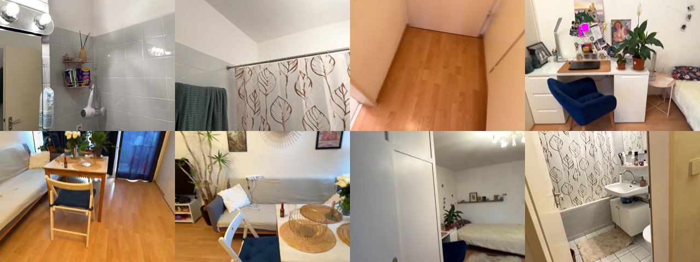

**Absolute distance** ([▶ `scannetpp/f3d64c30f8`](data/previews/scannetpp/f3d64c30f8.webm) · [mp4](data/raw/VSI-Bench/scannetpp/f3d64c30f8.mp4), id 1746): *Measuring from the closest point of each object, what is the distance between the cup and the heater (in meters)?*
GT **2.3** · 2B: `2.0` (MRA 0.8) · 4B: `3.0` (MRA 0.4)

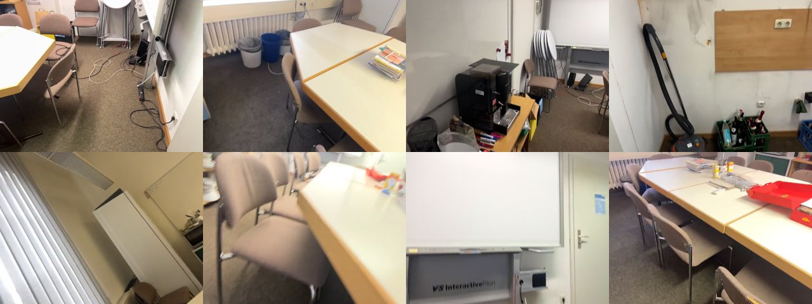

**Object size** ([▶ `scannet/scene0693_00`](data/previews/scannet/scene0693_00.webm) · [mp4](data/raw/VSI-Bench/scannet/scene0693_00.mp4), id 3330): *What is the length of the longest dimension (length, width, or height) of the trash bin, measured in centimeters?*
GT **26** · 2B: `34` (MRA 0.4) · 4B: `35` (MRA 0.4)

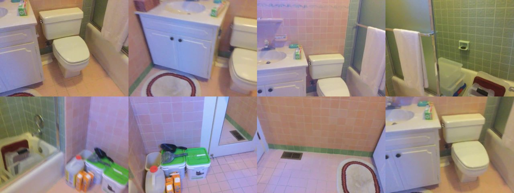

**Room size** ([▶ `scannet/scene0144_00`](data/previews/scannet/scene0144_00.webm) · [mp4](data/raw/VSI-Bench/scannet/scene0144_00.mp4), id 3834): *What is the size of this room (in square meters)? If multiple rooms are shown, estimate the size of the combined space.*
GT **13.0** · 2B: `18.4` (MRA 0.2) · 4B: `17.0` (MRA 0.4)

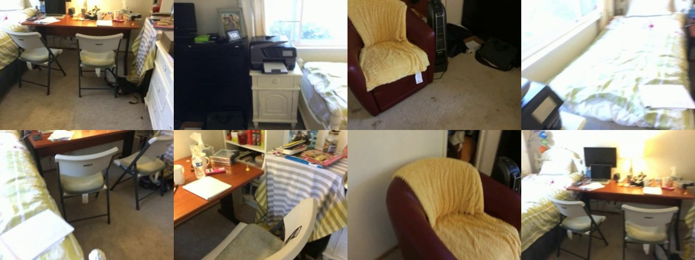

**Relative distance** ([▶ `arkitscenes/42897629`](data/previews/arkitscenes/42897629.webm) · [mp4](data/raw/VSI-Bench/arkitscenes/42897629.mp4), id 1358): *Which of these objects (washer, tv, sofa, table) is the closest to the stove?*
A. washer · B. tv · C. sofa · D. table. GT **D** · 2B: `D. table` ✓ · 4B: `D. table` ✓

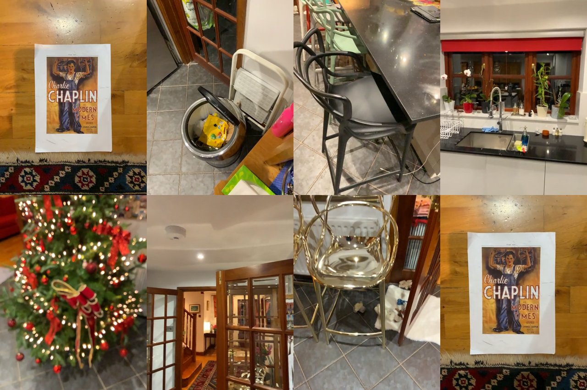

**Relative direction, hard** ([▶ `arkitscenes/47430468`](data/previews/arkitscenes/47430468.webm) · [mp4](data/raw/VSI-Bench/arkitscenes/47430468.mp4), id 1097): *If I am standing by the stove and facing the stool, is the refrigerator to my front-left, front-right, back-left, or back-right?*
A. back-left · B. front-left · C. back-right · D. front-right. GT **D** · 2B: `B. front-left` ✗ · 4B: `A. back-left` ✗

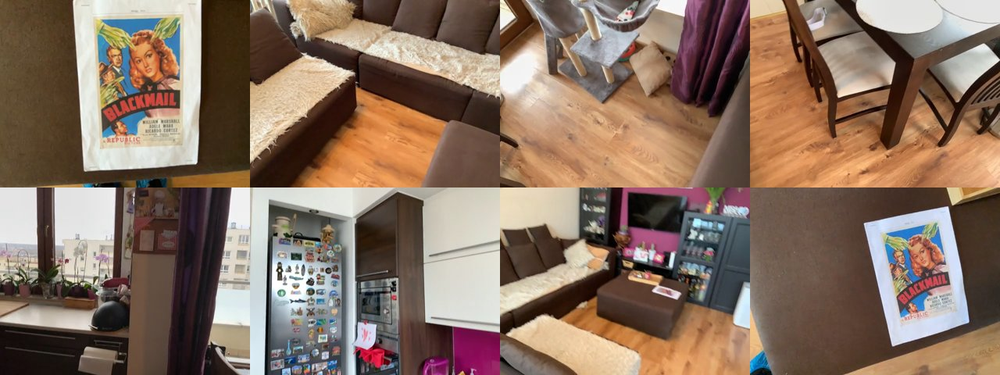

**Route planning** ([▶ `scannet/scene0412_00`](data/previews/scannet/scene0412_00.webm) · [mp4](data/raw/VSI-Bench/scannet/scene0412_00.mp4), id 5119): *You are a robot beginning at the orange traffic cone and facing the sink. You want to navigate to the elevator. ... 1. [please fill in] 2. Go forward until the metal rack 3. [please fill in] 4. Go forward until the cardboard boxes 5. [please fill in] 6. Go forward until the trash bin 7. [please fill in] 8. Go forward until the elevator.*
A. R,R,R,R · B. R,R,L,R · C. Back,L,L,R · D. L,L,R,R. GT **B** · 2B: `A` ✗ · 4B: `A` ✗

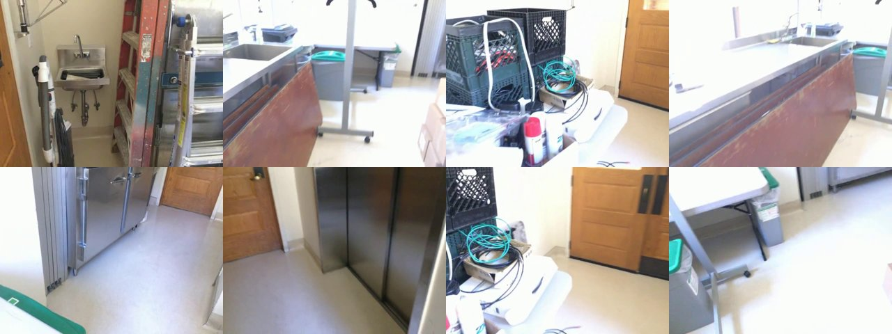

**Appearance order** ([▶ `scannet/scene0207_02`](data/previews/scannet/scene0207_02.webm) · [mp4](data/raw/VSI-Bench/scannet/scene0207_02.mp4), id 4207): *What will be the first-time appearance order of the following categories in the video: door, backpack, mirror, closet?*
A. door, backpack, mirror, closet · B. mirror, backpack, closet, door · C. closet, backpack, door, mirror · D. closet, mirror, backpack, door. GT **C** · 2B: `C. closet, backpack, door, mirror` ✓ · 4B: same ✓

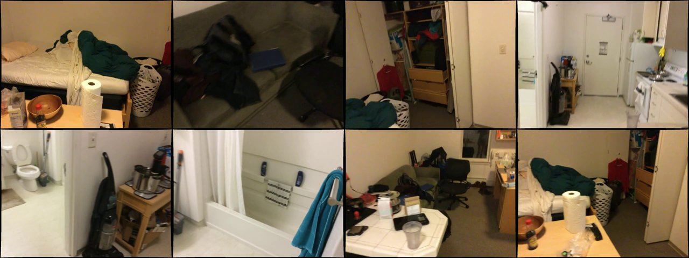

### MMSI-Bench

**Positional relationship, Cam.–Obj.** (medium, id 197): *These two photos were taken by you in succession. When you took the first photo, which pillow in the second photo is the farthest white pillow from you, and is it on your left or right?*
A: left one, on the left · B: right one, on the right · C: left one, on the right · D: right one, on the left. GT **A** · 2B: `C: The one on the left, on the right,` ✗ · 4B: `A` ✓

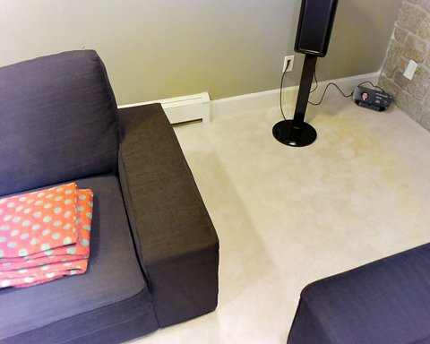 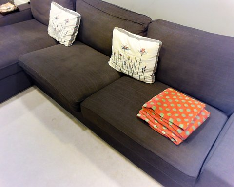

**Camera motion** (easy, id 320): *First-person continuous shooting, in which direction is the camera moving?*
A: Not moving · B: Left · C: Up · D: Right. GT **A** · 2B: `D` ✗ · 4B: `A` ✓

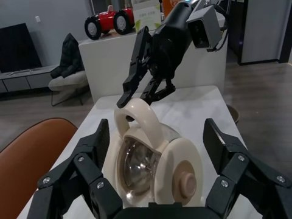 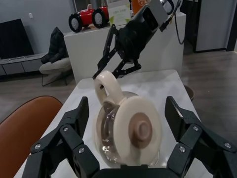

**Attribute, measurement** (hard, id 810): *Which has a larger volume, the cardboard box or the printer?*
A: Printer · B: Cannot be determined · C: Cardboard box · D: The same size. GT **B** · 2B: `C: Cardboard box` ✗ · 4B: `C` ✗

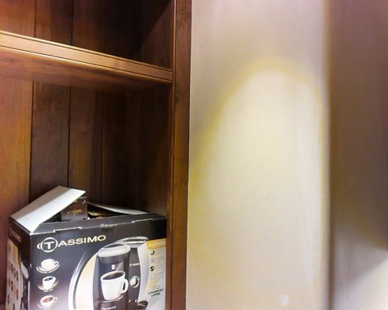 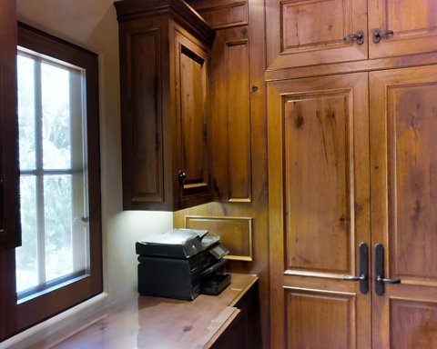

**Multi-step reasoning** (medium, id 535, 5 images): *Suppose I am taking the first picture facing north, then in which direction is the camera facing when taking the second picture?*
A: Southwest · B: Northwest · C: Northeast · D: Southeast. GT **A** · 2B: `C: Northeast` ✗ · 4B: `C` ✗

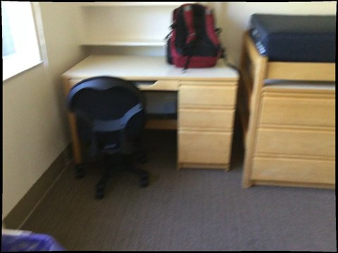 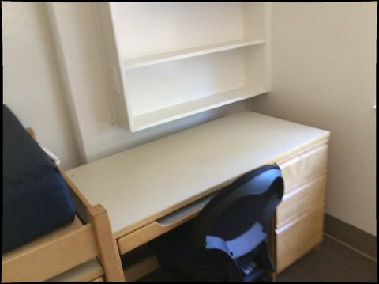 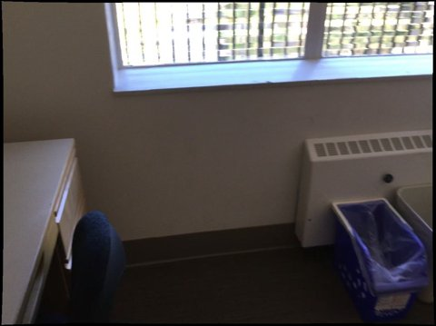 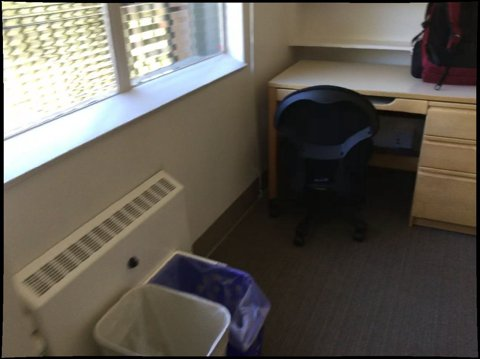 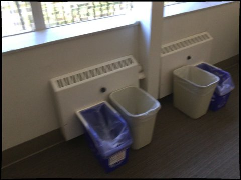

### VSI-Bench-Debiased: where 4B fails

Ten debiased questions that Qwen3-VL-4B (32 frames) got completely wrong: a wrong letter, or for numeric questions
MRA 0 (more than 50% relative error). They are drawn round-robin over the 8 tasks (`make_examples.py
--failures-of 4B_f32`), so they show *kinds* of failure, not how often each happens. For frequency, the share of
debiased questions per task where 4B scores 0:

| Task | Count | Abs. dist | Obj. size | Room size | Rel. dist | Rel. dir | Route | Appear. order |
|---|---|---|---|---|---|---|---|---|
| Questions | 251 | 434 | 353 | 200 | 310 | 382 | 114 | 318 |
| Score 0 (%) | 12.0 | 29.5 | 12.2 | 11.0 | 46.8 | 51.0 | 77.2 | 42.5 |

What the examples show:
* **Counting:** many instances of a small repeated object (ceiling lights: 8 → 2, 12 → 4) are severely undercounted.
* **Distances:** large distances in big spaces collapse to "room-scale" guesses (9.1 m → 2.3 m, 9.1 m → 1.0 m).
* **Sizes:** small objects are overestimated (exhaust fan 12 cm → 25 cm).
* **Viewpoint tasks:** relative direction and route planning fail even on the easy left/right variant. On the
  debiased set, route planning (22.8% accuracy) is below chance.
* **2B vs 4B:** in 2 of the 10 cases 2B is right where 4B is wrong, so individual questions say little about which
  model is better.

**1. object_counting** ([▶ `scannetpp/bde1e479ad`](data/previews/scannetpp/bde1e479ad.webm) · [mp4](data/raw/VSI-Bench/scannetpp/bde1e479ad.mp4), id 2556)

> How many ceiling light(s) are in this room?

GT **8** · **4B: `2` (MRA 0.0)** · 2B: `4` (MRA 0.1)

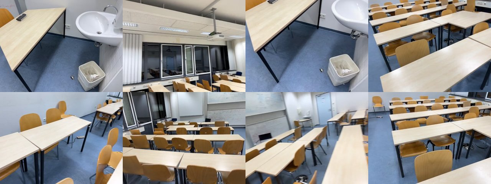

**2. object_abs_distance** ([▶ `scannetpp/27dd4da69e`](data/previews/scannetpp/27dd4da69e.webm) · [mp4](data/raw/VSI-Bench/scannetpp/27dd4da69e.mp4), id 1794)

> Measuring from the closest point of each object, what is the distance between the basket and the cutting board (in meters)?

GT **9.1** · **4B: `2.3` (MRA 0.0)** · 2B: `2.0` (MRA 0.0)

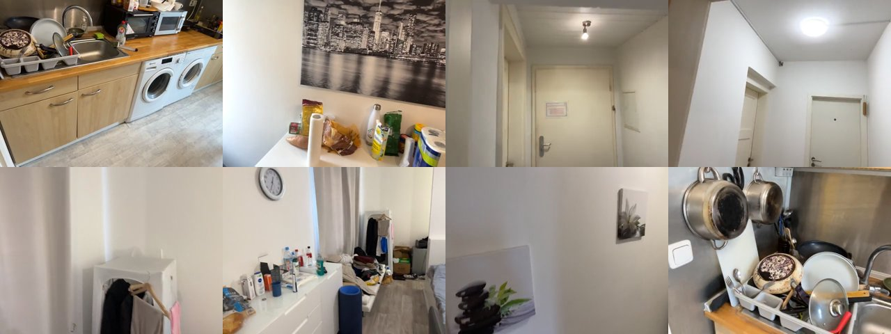

**3. object_size_estimation** ([▶ `scannetpp/286b55a2bf`](data/previews/scannetpp/286b55a2bf.webm) · [mp4](data/raw/VSI-Bench/scannetpp/286b55a2bf.mp4), id 2288)

> What is the length of the longest dimension (length, width, or height) of the exhaust fan, measured in centimeters?

GT **12** · **4B: `25` (MRA 0.0)** · 2B: `24` (MRA 0.0)

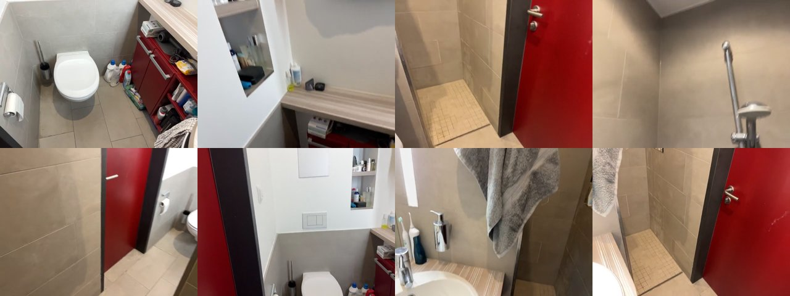

**4. room_size_estimation** ([▶ `scannetpp/3f15a9266d`](data/previews/scannetpp/3f15a9266d.webm) · [mp4](data/raw/VSI-Bench/scannetpp/3f15a9266d.mp4), id 2672)

> What is the size of this room (in square meters)? 
> If multiple rooms are shown, estimate the size of the combined space.

GT **11.9** · **4B: `18.0` (MRA 0.0)** · 2B: `20.0` (MRA 0.0)

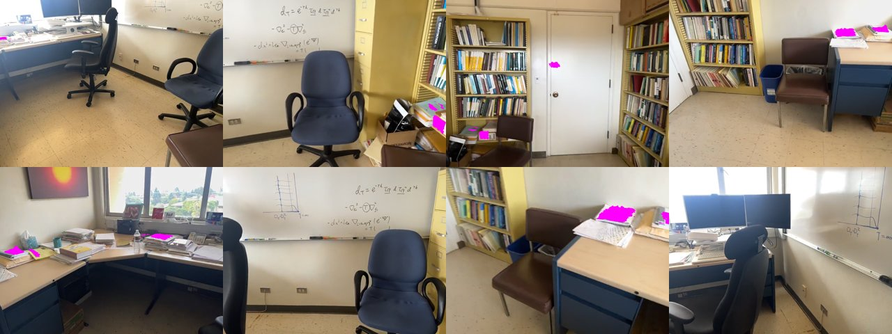

**5. object_rel_distance** ([▶ `scannetpp/21d970d8de`](data/previews/scannetpp/21d970d8de.webm) · [mp4](data/raw/VSI-Bench/scannetpp/21d970d8de.mp4), id 1988)

> Measuring from the closest point of each object, which of these objects (tv, whiteboard, telephone, chair) is the closest to the door?

A. tv · B. whiteboard · C. telephone · D. chair

GT **B** · **4B: `D. chair` ✗** · 2B: `B. whiteboard` ✓

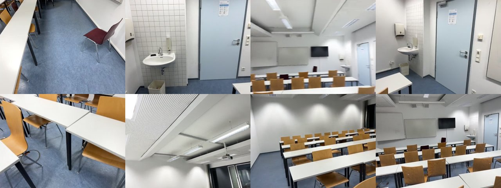

**6. object_rel_direction_easy** ([▶ `scannet/scene0357_01`](data/previews/scannet/scene0357_01.webm) · [mp4](data/raw/VSI-Bench/scannet/scene0357_01.mp4), id 3710)

> If I am standing by the window and facing the towel, is the table to the left or the right of the towel?

A. left · B. right

GT **B** · **4B: `A. left` ✗** · 2B: `A. left` ✗

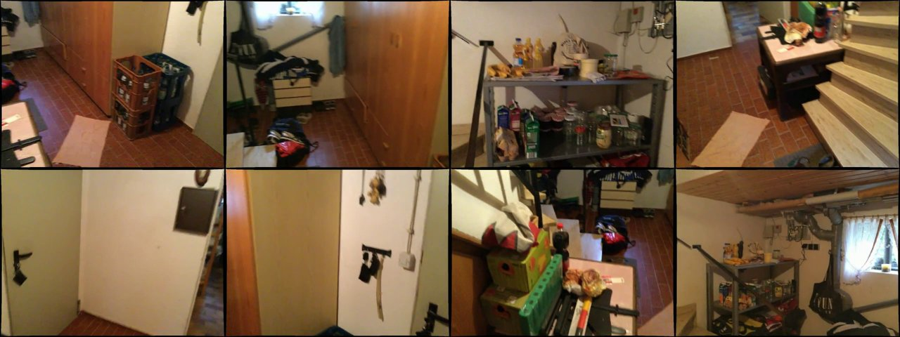

**7. route_planning** ([▶ `arkitscenes/47331262`](data/previews/arkitscenes/47331262.webm) · [mp4](data/raw/VSI-Bench/arkitscenes/47331262.mp4), id 5073)

> You are a robot beginning at the corner of the table towards the sofa and facing the table. You want to navigate to the corner fan. You will perform the following actions (Note: for each [please fill in], choose either 'turn back,' 'turn left,' or 'turn right.'): 1. [please fill in] 2. Go forward until the bookshelf 3. [please fill in] 4. Go forward until the wall. You have reached the final destination.

A. Turn Back, Turn Right · B. Turn Right, Turn Left · C. Turn Left, Turn Right · D. Turn Right, Turn Right

GT **C** · **4B: `D. Turn Right, Turn Right` ✗** · 2B: `B. Turn Right, Turn Left` ✗

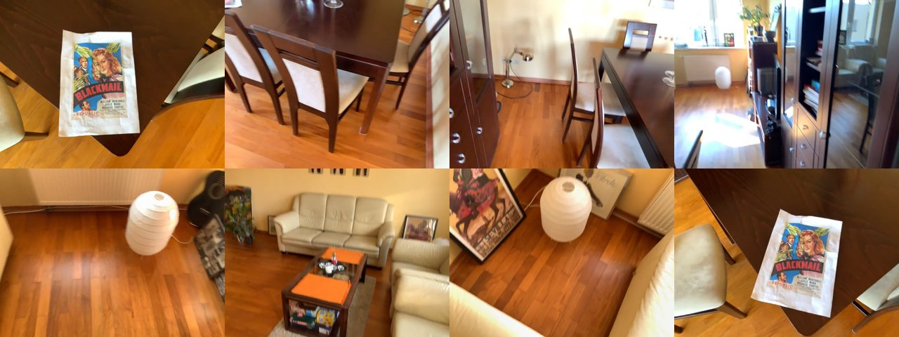

**8. obj_appearance_order** ([▶ `scannet/scene0580_01`](data/previews/scannet/scene0580_01.webm) · [mp4](data/raw/VSI-Bench/scannet/scene0580_01.mp4), id 4069)

> What will be the first-time appearance order of the following categories in the video: door, table, chair, bookshelf?

A. chair, bookshelf, door, table · B. bookshelf, table, chair, door · C. door, table, chair, bookshelf · D. door, chair, table, bookshelf

GT **D** · **4B: `C. door, table, chair, bookshelf` ✗** · 2B: `D. door, chair, table, bookshelf` ✓

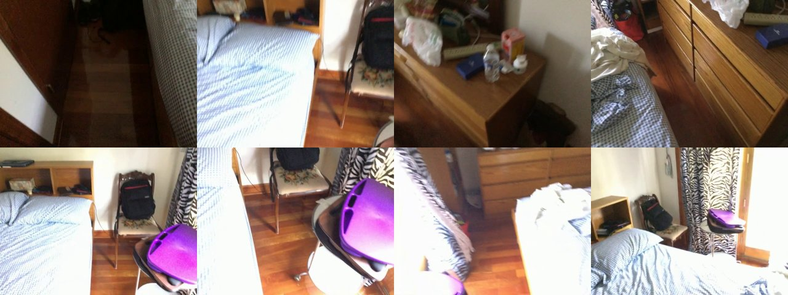

**9. object_counting** ([▶ `scannetpp/21d970d8de`](data/previews/scannetpp/21d970d8de.webm) · [mp4](data/raw/VSI-Bench/scannetpp/21d970d8de.mp4), id 2546)

> How many ceiling light(s) are in this room?

GT **12** · **4B: `4` (MRA 0.0)** · 2B: `4` (MRA 0.0)


**10. object_abs_distance** ([▶ `arkitscenes/42897629`](data/previews/arkitscenes/42897629.webm) · [mp4](data/raw/VSI-Bench/arkitscenes/42897629.mp4), id 751)

> Measuring from the closest point of each object, what is the distance between the tv and the refrigerator (in meters)?

GT **9.1** · **4B: `1.0` (MRA 0.0)** · 2B: `4.4` (MRA 0.0)


## VGGT reconstructions

`src/extract_vggt.py` runs the frozen [VGGT-1B](https://huggingface.co/facebook/VGGT-1B) ([2503.11651](https://arxiv.org/abs/2503.11651))
once per video on 128 uniformly spaced frames (one joint bf16 forward pass), following the candidate-frame setup of
Spatial-MLLM's space-aware sampling (`third_party/Spatial-MLLM/src/sampling/sa_sampling.py`). All 288 VSI-Bench
videos are done: about 4 s of VGGT and 14 s in total per video on one B200 (14.7 GB peak), about 20 min on 4 GPUs.
Each video takes about 820 MiB, 232 GB in total, in `data/vggt/<dataset>/<scene>/`:

| file | shape | content |
|---|---|---|
| `meta.json` | | video, input size, frame counts, timings |
| `frame_indices.npy` | int32 [128] | frame indices in the original video |
| `extrinsic.npy`, `intrinsic.npy` | float32 [128,3,4], [128,3,3] | OpenCV camera-from-world (world = first camera), intrinsics in input pixels |
| `depth.npy`, `depth_conf.npy` | float16 [128,H,W] | depth and confidence (H x W = 392 x 518, or 518 x 392 for portrait) |
| `world_points.npy`, `world_points_conf.npy` | float16 [128,H,W,3], [128,H,W] | point head output (what the space-aware sampler uses) |
| `tokens.npy` | float16 [128,1036,2048] | last aggregator layer, patch tokens (the layer Spatial-MLLM's connector uses) |
| `special_tokens.npy` | float16 [128,5,2048] | same layer, camera + 4 register tokens |
| `cloud.npz` | ~250k points | fused cloud from depth + cameras (xyz, rgb, frame), for viewing |

All arrays load with `np.load(..., mmap_mode="r")`. VGGT's geometry is up to an unknown global scale per scene
(median depth is about 0.4 units), so metric answers need a separate scale source.

**Portrait videos.** 57 ARKitScenes videos are upright 480x640 portrait. Spatial-MLLM rotates portrait frames by
-90 degrees, which turns these sideways, and VGGT then fails on them (median depth confidence 1.0, the minimum of
its `1 + exp(x)` confidence, against about 5.8 for the landscape ARKitScenes videos). `data/vggt/` therefore keeps
them upright (long side 518, the same 1036 patches); median confidence becomes 3.9. The rotated outputs, which a
faithful reproduction of Spatial-MLLM's sampler would see, are in `data/vggt_portrait_rotated/` (`--portrait rotate`).
Low confidence on ScanNet (median 3.4) mostly reflects darker, blurrier footage rather than failed reconstructions.

`src/show_vggt.py <dataset>/<scene>` draws a check figure (frames, depth, confidence, top and front view of the
cloud with the camera path coloured from purple at the first frame to yellow at the last):

| ScanNet++ | ARKitScenes |
|---|---|
| 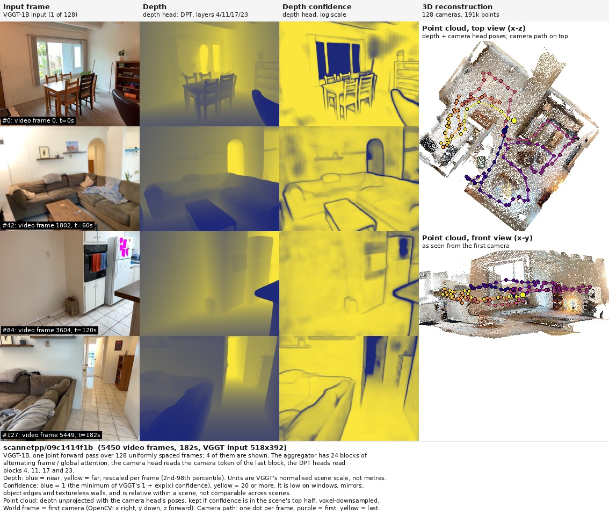 | 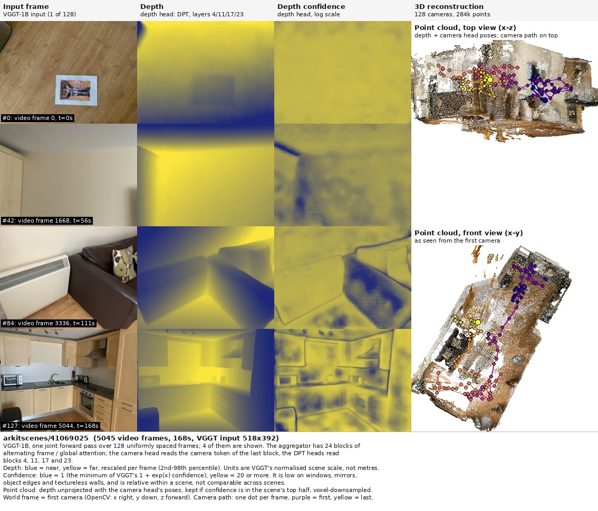 |
| **ARKitScenes, portrait (kept upright)** | **ScanNet (low confidence, still coherent)** |
| 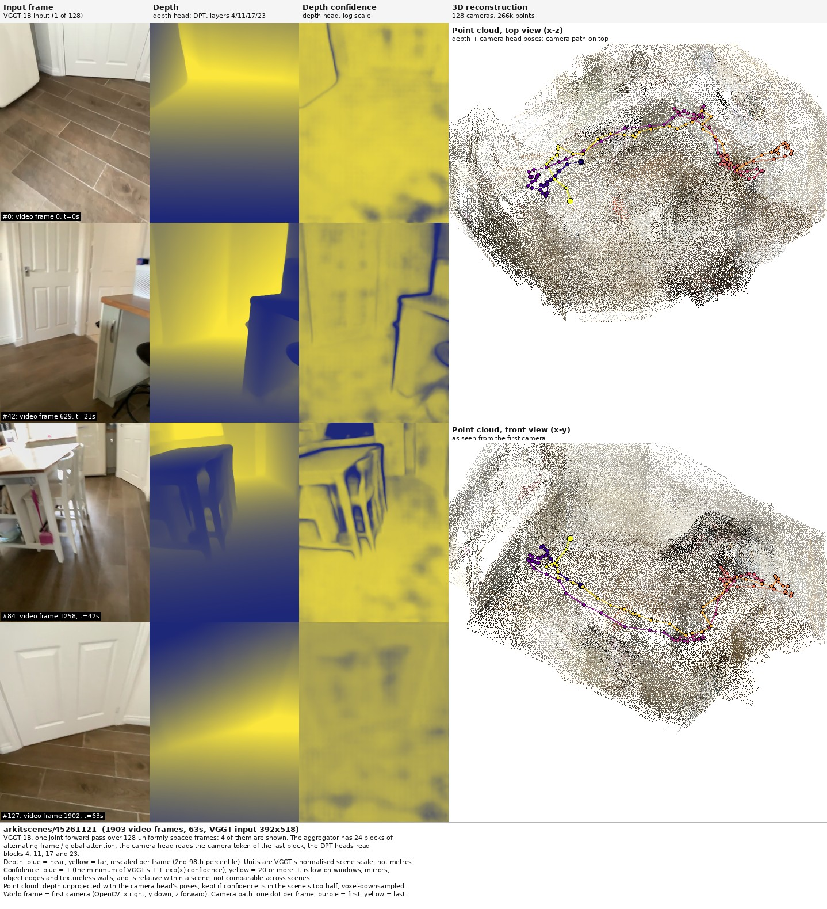 | 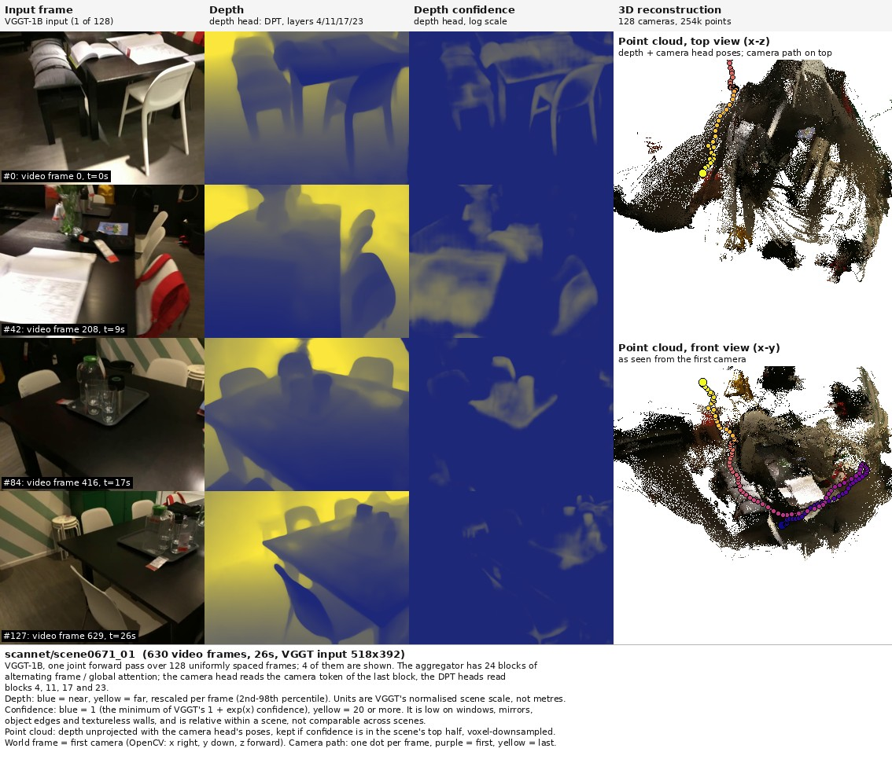 |

A step-by-step example of how these outputs are used (frame sampling, Spatial-MLLM's model, training and
inference) is in [docs/walkthrough.md](docs/walkthrough.md).

## Next steps

1. Check the remaining gap to the Qwen report (frame count, resolution, prompt, decoding).
2. Reproduce Spatial-MLLM's space-aware frame sampling from the saved point maps and evaluate Qwen3-VL with those
   frames; combine VGGT geometry with a detector to get 3D object boxes.
3. Cue injection: a text "scene sheet", 3D position embeddings on image tokens, or per-frame pose tokens.
4. LoRA fine-tune on a few thousand spatial QA pairs (e.g. SPAR-7M, [2503.22976](https://arxiv.org/abs/2503.22976)),
   with no scene overlap with the test scenes. Ablations: cues without fine-tuning, fine-tuning without cues (the
   key control), fine-tuning with cues, and ground-truth 3D boxes as an upper bound.
