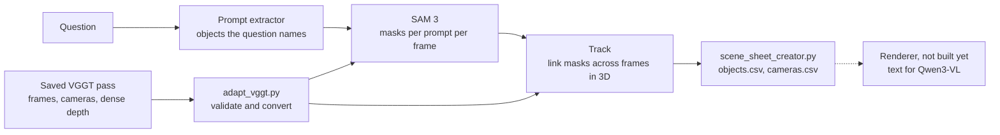

# Scene sheet: explicit 3D cues as text

**Status (2026-11-18):** the pipeline that builds scene sheets is implemented in `src/mvp/openvocab_adapter/`
([how to run it](openvocab_adapter_usage.md)). The VLM experiments haven't run yet, and their design is in
[`experiments/scene_sheet_vs_video.md`](../experiments/scene_sheet_vs_video.md) (a draft). The sheet was first
proposed here on 2026-10-26. This page now describes what was built, and
[What changed from the proposal](#what-changed-from-the-proposal) lists where the two differ.

This is item 3 ("cue injection: a text scene sheet") of the README's next steps. It is an alternative to the gated
cross-attention plan in `docs/idea.md`. That plan trains new layers that read VGGT features. This one trains nothing:
it turns VGGT's 3D reconstruction into a written list of objects that goes into the prompt.

## Summary

For each question we write a **scene sheet**, a table of the objects the question names, with where they are in 3D
and how big they are. A second table gives the camera's position in each frame. To build the sheet, SAM 3 (an
open-vocabulary segmentation model) segments the named objects in every frame. OpenVocab-4D's tracker then links
those segments across frames into objects, and the saved VGGT depth and cameras place each object in 3D. A second
source, VSI-Bench's ground-truth boxes, gives a **perfect sheet** to compare against. The experiment then tests
Qwen3-VL with video only, sheet only, and both.

Why: in the zero-shot baselines, more frames did not help relative direction (40–46) or route planning (about 29,
which is chance). Both tasks need a 3D map of the room, and the scene sheet hands the model one directly.

## What changed from the proposal

| | Proposal (2026-10-26) | Implementation |
|---|---|---|
| Segmentation | A model with a fixed list of indoor classes, or an open-vocabulary one | SAM 3 (open-vocabulary), prompted with the objects the question names |
| Which objects | Everything, with filtering by the question as an option | Only the objects the question names, picked by `prompt_object_extractor.py` |
| 3D points | VGGT's `world_points.npy` under each mask | VGGT's per-pixel `depth.npy` and cameras, unprojected. Both come from the same VGGT pass |
| One object or two | Same label and overlapping boxes, or centres closer than half the box diagonal | OpenVocab-4D's tracker: 3D-centre matching plus DINOv2 appearance re-identification |
| Object names | `chair_1`, `chair_2`, in order of first appearance | `concept` + `track_id` (`chair`, `5`). Rows are grouped by prompt, then sorted by track id |
| Position and size | 3D bounding box and its centre | Median of the object's 3D points, and the extent of the points along each world axis |
| File format | One JSON per video: objects, per-frame visible objects with distances, pairwise closest-point distances | Two CSVs per question: `objects.csv` (position, size, frames seen) and `cameras.csv` (camera pose per frame) |
| Pairwise distances | An N × N table of closest-point distances | Not built |
| Text for the prompt | Rendered from the JSON | Not built yet |
| Perfect sheet | From ground-truth 3D boxes | `scene_sheet_creator.py --source gold`, from VSI-Bench's metadata, in metres |

## Pipeline

Nothing is trained. SAM 3 runs, and so does DINOv2 for re-identification. VGGT isn't run again, because its saved
outputs are reused. `question_scene_sheet.py` runs every step for one scene and one question.



1. **Pick the prompts.** `prompt_object_extractor.py` parses the question with spaCy and keeps the nouns that
   WordNet says are physical things. "Measuring from the closest point of each object, which of these objects
   (table, chair, door, telephone) is the closest to the fan?" gives `table, chair, door, telephone, fan`. Spatial
   words ("left", "corner"), generic nouns ("object", "point") and words for the video ("camera", "frame") are
   dropped. If nothing is kept, every noun phrase is used instead (the *syntactic fallback*).
2. **Get the geometry.** `adapt_vggt.py` takes the saved VGGT pass of the scene and writes the selected frames,
   their cameras and their per-pixel depth in OpenVocab-4D's format. It first checks the saved outputs: the rotations
   are proper rotations and frame 0 is the world frame, every patch point projects into its own 14×14 patch, the
   point-cloud colours match the frames, and the dense depth reproduces the exported patch points. If any check
   fails, nothing is written.
3. **Segment.** `sam3_infer.py` runs SAM 3 on every selected frame, once per prompt, and saves the masks with a
   score of at least 0.5.
4. **Track.** OpenVocab-4D's track stage (`openvocab-4D-main/trackA/milestone4_video.py --stages track`) reads the
   saved masks. This step replaces the proposal's merge rule. *Since 2026-11-24 the pipeline's defaults differ from
   the rules below, which are kept as `--association centroid --depth-rule global`.* The centroid radius came from
   the first frame alone, about 0.15 m, while the same object's visible centre moves about 0.65 m between the 16
   frames. So a detection now continues the track whose 3D points it overlaps (voxels about 10 cm across, within one
   voxel of the track's). The confident-depth rule dropped 38% of SAM 3's detections of named objects, so a pixel now
   counts when its confidence reaches the lower of the global threshold and the mask's own median, and a detection
   needs 50 such pixels. The original rules:
   - It keeps a detection if its score is at least 0.55 and it covers at least 300 pixels with confident depth. Depth
     counts as confident when it is in the top 45% of VGGT's depth confidence over the whole video. The detection
     is placed at the mean 3D point of those pixels.
   - Frame by frame, a detection continues a track of the same prompt if its centre is within 5% of the scene's
     diagonal of the track's centre, and the track was last seen at most 40 frames earlier. Otherwise it can re-join
     an older or farther track, within 15% of the diagonal, if the two look alike: DINOv2 cosine similarity of at
     least 0.6.
   - After the pass, two fragments that look alike and lie close together are merged, unless both appear in more
     than 2 of the same frames.
   - Tracks seen in too few frames are dropped. The minimum scales linearly with the number of frames: 1 of 16
     (the default selection), 2 of 64, 4 of 128 (`min_track_frames` in `milestone4_video.py`;
     `--min-track-frames N` there fixes it).
5. **Write the sheet.** `scene_sheet_creator.py` collects each track's 3D points and writes the two CSVs. Only
   frames where the object has enough pixels of usable depth count, by the same rule as tracking (300 confident pixels
   under the original rule).

Geometry, masks and tracks are kept for each scene. A second question about the same scene runs SAM 3 and tracking
only for prompts that have no tracks yet.

### Reusing the VGGT cache

The sheet uses the same VGGT-1B pass as the rest of the project: one pass per video over 128 uniformly spaced
frames. It is stored in two places:

- **The export**, `tasks/vggt_data/scenes/<dataset>/<scene>/`, for 75 scenes: `frames/`, `cameras.npz`,
  `patch_points.npz`, `point_cloud.npz`, `questions.jsonl`, and `meta.json`. `meta.json` holds the frame subsets
  `uniform16`, `uniform32`, `space_aware16` and `space_aware32`.
- **The dense depth**, `data/vggt/<dataset>/<scene>/depth.npy` and `depth_conf.npy`, which is only on the cluster.
  The adapter also checks that the `extrinsic.npy`, `intrinsic.npy` and `frame_indices.npy` stored there match the
  export.

World coordinates are the first camera's, in the OpenCV convention (x right, y down, z forward), and the scale is
arbitrary. SAM 3's masks are resized to VGGT's depth grid inside the track stage.

**Without the dense depth**, `--patch-depth-fallback` approximates it from the exported patch points, at one depth
per 14×14 patch. This is coarser: object outlines are blocky, and sizes can take in a strip of background. On the
synthetic test scene, centres move by less than 5% of the object's size, and volumes come out about 10% smaller.
`question.json` records which depth was used.

**Frames (since 2026-11-24).** `question_scene_sheet.py` (and so `scene_sheet_report.py`) uses all 128 frames by
default (`--frames all`), so that neighbouring frames overlap and tracking can follow objects. The sheet keeps all 128
frame columns. When the prompt is written (`mvp.benchmarks.scene_sheet`, visibility `nearby`), they are mapped onto
the 16 frames the VLM sees. An object counts as seen in one of them if it was seen there, or in at least 2 of the 4
frames just before it and 2 of the 4 just after. An object seen only between them gets the nearest one. Before that:

**Frames (before 2026-11-24).** `question_scene_sheet.py` (and so `scene_sheet_report.py`) used 16 frames uniformly sampled from the 128
by default, `subset:uniform16` of `meta.json`: the 16 frames that the VLM sees with `--sampling uniform128`
(Qwen3-VL-4B, 16 frames: 51.9 overall), so the sheet and the VLM see the same frames. `--frames all` uses all 128.

## Scene sheet format

Each question gets a folder, `sheets/<prompts>/`, with three files. The model never reads them directly. A renderer
will turn them into prompt text, and that renderer isn't built yet.

### `objects.csv`

One row per tracked object.

| Column | Meaning |
|---|---|
| `object_id` | Row number: 0, 1, 2, … |
| `concept` | The SAM 3 prompt that found the object (`chair`) |
| `track_id` | The track's number within that prompt, matching `tracks/<concept>.npz`. Numbers follow the order in which the tracks were started, with gaps where short tracks were dropped or fragments merged |
| `x`, `y`, `z` | The median of the object's 3D points over all frames, taken separately on each axis, in the world frame |
| `size_x`, `size_y`, `size_z`, `size` | The extent of the points along each world axis (from the 0.02nd to the 99.98th percentile, `--size-trim`), and the product of the three. Leave them out with `--no-size` |
| `num_frames` | The number of frames the object was seen in |
| `frame_000` … `frame_127` | 1 if the object was seen in that frame, else 0 |

With `--relative-positions`, each frame has three columns, `frame_<t>_x`, `_y` and `_z`, in place of the 0/1 flag.
They hold the object's median position in that frame's camera coordinates, and are empty when the object isn't seen.
Rows are grouped by prompt, in the order the question names the objects, then sorted by track id. `concept` and
`track_id` together name an object uniquely ("chair 5").

### `cameras.csv`

One row per selected frame.

| Column | Meaning |
|---|---|
| `frame`, `image` | The frame's number in the selection (the `t` of `frame_<t>`), and its image file |
| `x`, `y`, `z` | Camera centre, in the world frame |
| `qw`, `qx`, `qy`, `qz` | Camera orientation as a unit quaternion: the rotation from camera axes to world axes |
| `forward_x`, `forward_y`, `forward_z` | The direction the camera faces (camera +z), in world coordinates |

### `question.json`

This file records the inputs and settings: the scene and question, the prompts, how they were found (`prompt_mode`:
`full`, `syntactic fallback` or `syntactic`), the frame selection, the tracking settings, and which depth was used
(`dense` or `patch_points`).

### The perfect sheet

`scene_sheet_creator.py --source gold` writes the same columns, up to `size`, from VSI-Bench's ground-truth boxes
([thinking-in-space](https://github.com/vision-x-nyu/thinking-in-space) `data/meta_info/`, commit `ba7a6b2`). There is
one row per box. Each row gives the box's centre and extent in metres, in the dataset's frame (z up). Prompts are
matched to class names regardless of case or a plural "s" (plus the alias "coat rack" → "coat hanger"). Gold sheets
have no per-frame columns and no `cameras.csv`. The metadata has nothing per frame, and VGGT's cameras are in a
different frame and scale with nothing to align them by. `sheet.json` records the source and the matched classes.

### Example

This is the question above, on `scannet/scene0025_01`, with 128 frames (`--frames all`, the default when it was
run; the default is now 16) and re-identification on. It was run locally, so it used the patch-point depth approximation. The 128 frame columns are cut:

```text
object_id,concept,track_id,x,y,z,size_x,size_y,size_z,size,num_frames
0,table,1,0.607989,0.165686,0.823529,0.326722,0.374568,0.252647,0.0309188,10
1,table,2,0.729091,0.222638,0.441652,0.705032,0.327505,0.713551,0.16476,7
...                                                    (7 tables in all)
7,chair,1,0.456181,0.0446032,0.989077,0.428606,0.471011,0.416244,0.0840306,6
...                                                    (4 chairs in all)
11,door,1,-0.346897,-0.178234,0.783728,0.385473,1.04383,0.766152,0.308277,33
12,door,6,-0.498932,-0.397644,0.516914,0.34796,0.72016,0.656619,0.16454,6
13,telephone,1,1.0656,0.492754,-0.285694,0.0912513,0.060178,0.0928881,0.000510078,8
```

Here is the perfect sheet for the same prompts, in metres:

```text
object_id,concept,track_id,x,y,z,size_x,size_y,size_z,size
0,table,1,0.886143,0.324196,-0.582737,3.13297,2.027,0.872624,5.54161
1,table,2,1.18117,-0.748299,-0.395667,2.50078,2.23334,1.24102,6.93125
2,chair,1,0.915205,-1.33816,-0.566614,1.3365,1.29523,1.13499,1.96475
3,chair,2,1.08988,0.715364,-0.465222,0.758704,0.555743,1.02553,0.432408
4,door,1,-2.35493,0.453892,0.0330963,0.40896,1.17544,2.1944,1.05486
5,telephone,1,1.64108,0.00681922,-0.0872051,0.33143,0.349815,0.19677,0.0228133
6,fan,1,-1.64329,-0.455992,-0.51139,0.414052,0.376798,0.980983,0.153047
```

This is one question with approximate depth, so it is not a measurement. It does show both errors the experiment
must count. The pipeline lists 7 tables, 4 chairs and 2 doors where the labels have 2, 2 and 1. It also finds no
fan, which is the object the question asks about.

### What the model reads

Not built yet. The experiment fixes some choices. Every condition gets the global columns only, position and size,
because gold sheets have no per-frame part. The sheet goes between the video and the question. Still open: the text
format (CSV, JSON or prose), how objects are named in the text, and whether pairwise distances are added (see
[Open questions](#open-questions)).

## Units and scale

The two kinds of sheet use different units and frames, and nothing converts between them:

- **Pipeline sheet:** VGGT's units and the first camera's frame. The axes follow that camera (y points down in that
  frame, which isn't necessarily the floor's down), the scale differs from video to video, and `size` is in those
  units cubed.
- **Perfect sheet:** metres, in the dataset's frame, with z up.

The sheet must say which it is, or the model will read 1.35 as 1.35 m.

- **Not affected by the scale:** counting, relative distance, relative direction, route planning, appearance order.
  These only need comparisons, positions or order.
- **Affected:** absolute distance (m), object size (cm), room size (m²). These need a conversion to real units, for
  example by scaling the scene to a reference object of known size (a door is about 2 m tall). Until then, the model
  has to combine the sheet's ratios with its own sense of real sizes.

Because of this, comparing pipeline and perfect sheets mixes up perception errors with differences in units and
frame. The experiment reads the metric tasks and relative direction separately for that reason.

## Checking the pipeline

**The saved VGGT outputs against OpenVocab-4D's own VGGT.** This checks that `adapt_vggt.py` converts the saved
reconstruction correctly. It ran on 10 scenes with 64 frames each and no re-identification, and both runs used the
same SAM 3 masks (`src/mvp/openvocab_adapter/README.md`, results in `tasks/openvocab_adapter/results/SUMMARY.md`):

- **The 3D positions agree:** the median object error is 0.6–1.8% of the scene's size (pass mark ≤ 5%). Scene-sheet
  positions are off by 0.6–1.3%.
- **The tracks don't:** 29–73% of tracked pixels get the same object in both runs (pass mark ≥ 90%), and 54–100% of
  sheet rows appear in both sheets (pass mark ≥ 80%).
- **So 11 of the 12 comparisons are DIFFERS.** The twelfth, `arkitscenes/41069025`, failed the adapter's camera check
  ("world frame is frame 0") and produced nothing. The pass marks are provisional. Its frame-0 camera is 1.4e-3 off
  the origin, which is numerical noise, so the check's limit is now 1e-2 instead of 1e-3; two other ARKitScenes scenes
  (3.5e-3, 1.4e-3) failed it too.

**All 75 exported scenes** (`hpc/run_sheets.sh`, 16 uniform frames, default settings): all 2,728 questions get a
pipeline sheet and a gold sheet. On the 223 counting questions, the pipeline sheet has the true number of rows of the
asked class for 38, too many for 97, too few for 52 and none for 36 (732 rows for 662 objects); doors are the worst
(12 for 2, 15 for 5, 14 for 4). The gold sheets are exact for 218. So the same object is often split into several
rows, and small or rare objects are often missed.

**Each sheet.** `scene_sheet_report.py` builds the sheet of every question of a scene and checks its columns, values
and prompts. With `--source gold`, it runs on a CPU for any of the 288 VSI-Bench scenes.

**The perfect sheet as an answer key.** Fixed rules that read only the gold boxes score 97–100 on every task except
route planning (most waypoints aren't in the labels) and appearance order (nothing per frame), according to
[`experiments/scene_sheet_vs_video.md`](../experiments/scene_sheet_vs_video.md).

## Experiments

The design is in [`experiments/scene_sheet_vs_video.md`](../experiments/scene_sheet_vs_video.md) (a draft). It uses
the same VSI-Bench eval, models, prompt and scoring as the baselines. Only the prompt input changes. Each condition is
scored per task and overall, on the same frames.

| Condition | Video | Scene sheet | Role |
| --- | --- | --- | --- |
| A. Video only | yes | none | Baseline (4B, 16 frames uniform over 128: 51.9) |
| B. Sheet only | none | pipeline | Is the sheet alone enough? |
| C. Perfect sheet only | none | gold | B with no perception errors |
| D. Video + sheet | yes | pipeline | Does the sheet add anything to the video? |
| E. Video + perfect sheet | yes | gold | Upper bound |

D − A shows what the sheet adds to the video, and B − A whether the sheet alone is enough. C − B (without video) and
E − D (with video) show how much segmentation and tracking errors cost.

Two choices are fixed. The perfect sheet uses the same prompts as the pipeline sheet, so only the objects' source
differs. Every condition gets position and size only.

**Order of work.** Start with position and size, on the tasks they serve most directly: relative distance, relative
direction and route planning. Add per-frame columns and camera poses, scale calibration and the remaining tasks
after that works.

## Filtering by the question

This is now the default. A full sheet gets long, and VSI-Bench questions name the objects they ask about, so the
sheet lists only those objects, and SAM 3 segments only those, which also saves compute.

This doesn't work for every task:

- **Room size** needs the whole room. The extractor gives `room` for these questions, but SAM 3 can't segment a room,
  and the gold labels have no `room` class.
- **Counting** needs every instance of the named class. Filtering keeps them all.
- **Syntactic fallback:** when the full extractor keeps nothing, the fallback can give prompts that aren't objects,
  such as `distance` or `total length`. SAM 3 usually finds nothing for them, but it can also return something
  unrelated.

The planned check of full against filtered sheets on the same questions hasn't been run. A gold sheet lists every
class when it is given no `--prompts`. A pipeline sheet always needs a list of prompts.

