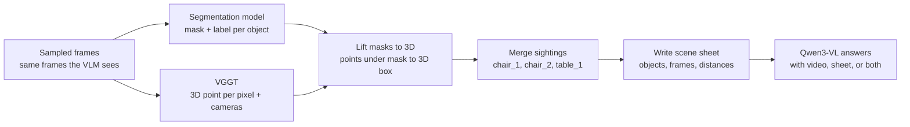

# Scene sheet: explicit 3D cues as text

Random idea from Dario: To prevent context lenght explosion, maybe the initial scene sheet should only contain the list of objects and then the model could "agentically" ask for distances between some pair which it might need to answer the questions (with the "tool" use rules explained in the prompt).

**Status (2026-10-26):** proposal, nothing run yet. This is item 3 ("cue injection: a text scene sheet") of the
README's next steps. It is an alternative to the gated cross-attention plan in `docs/idea.md`. That plan trains
new layers that read VGGT features. This one trains nothing: it turns VGGT's 3D points into a written list of
objects that goes into the prompt.

## Summary

We turn each video into a written **scene sheet**: a list of the objects in the room, where they are in 3D, how
big they are, and how far apart they are. We build it by running a 2D segmentation model on the frames and
placing each segment in 3D with VGGT's per-pixel 3D points. Then we test Qwen3-VL with three kinds of input
(video only, scene sheet only, and both) to see which works best.

Why: in the zero-shot baselines, more frames did not help relative direction (40–46) or route planning (about 29,
which is chance). Both tasks need a 3D map of the room, and the scene sheet hands the model one directly.

## Pipeline

Two frozen models run on the same frames. Neither is trained, and their outputs are combined into one object
list per video.



1. **Sample frames.** The VLM and the scene sheet must see the same frames.
2. **Segment each frame.** A 2D segmentation model outputs a pixel mask and a class label for each object
   ("chair", "table"). Segmentation models are small, so this fits on a small GPU.
3. **Get VGGT points.** For every pixel of every frame, VGGT gives a 3D point in one shared coordinate system,
   plus a confidence score, and each frame's camera position and facing direction. These already exist for
   every VSI-Bench video (see *Reusing the VGGT cache*).
4. **Lift each mask into 3D.** Collect the VGGT points under a mask's pixels, drop low-confidence points and
   outliers, and keep the rest as that object's point cloud.
5. **Box it.** From the point cloud, compute a 3D bounding box and its centre.
6. **Merge sightings across frames.** The same chair shows up in many frames. Sightings with the same label whose
   3D positions overlap become one object; sightings far apart become separate objects (`chair_1`, `chair_2`).
7. **Compute relations.** Per frame, each object's distance from the camera. Across the scene, the distance
   between every pair of objects.
8. **Write the scene sheet** and add it to the prompt next to the video, in place of the video, or not at all,
   depending on the experiment.

### Reusing the VGGT cache

`data/vggt/<dataset>/<scene>/` already holds one VGGT-1B pass per video over 128 uniformly spaced frames (README,
"VGGT features"): `world_points.npy` and `world_points_conf.npy` [128, H, W(, 3)], `extrinsic.npy`,
`intrinsic.npy` and `frame_indices.npy`. World coordinates are the first camera's, in the OpenCV convention.

So step 3 needs no new VGGT run, provided the VLM's frames are chosen from the 128 candidates. `--sampling
uniform128` in the VSI-Bench eval already does this (Qwen3-VL-4B, 16 frames: 51.9 overall). The masks must be
resized to VGGT's input grid (518 x 392, or 392 x 518 for portrait videos) before points are read under them.

## Scene sheet format

Each video gets one JSON file with three parts: a global **object list**, a **per-frame** list and a **pairwise
distance** table. The model never reads the JSON directly; we render it into short text for the prompt.

### Naming objects

Every object gets an id made of its label and a number: `chair_1`, `chair_2`, `table_1`. Numbers follow the
order in which objects first appear in the video, so `chair_1` is the first chair seen.

Two sightings with the same label become **one object** if their 3D boxes overlap or their centres are closer
than half the larger box's diagonal. Otherwise they are **separate objects**. The rule compares positions to the
object's own size, so it works even though VGGT's units are arbitrary. "Half the diagonal" is a starting value,
to be tuned on a few scenes with known object counts.

### Fields

| Part | Field | Meaning |
| --- | --- | --- |
| header | `scene`, `units`, `n_frames` | Which video, the unit note, how many frames were used |
| `objects[]` | `id`, `label` | `chair_2`, `chair` |
| `objects[]` | `center` | 3D centre [x, y, z] in the shared VGGT frame |
| `objects[]` | `size` | Box extent [x, y, z] |
| `objects[]` | `first_frame`, `frames` | First frame it appears in, and every frame it appears in |
| `frames[]` | `frame`, `camera` | Frame index; camera position and facing direction |
| `frames[]` | `visible[]` | Objects in that frame, each with its distance from the camera |
| `pairwise` | `ids`, `distance` | Object order, and an N × N matrix of distances between objects |

Pairwise distance is measured between the **closest points** of two objects' point clouds, not their centres.
VSI-Bench asks distance questions "measuring from the closest point of each object", so this matches.

### Example file

The numbers are made up to show the shape.

```json
{
  "scene": "scannet/scene0412_00",
  "units": "VGGT units (relative, not metres)",
  "n_frames": 32,
  "objects": [
    {"id": "table_1", "label": "table", "center": [0.10, 0.35, 1.20], "size": [0.80, 0.40, 0.60], "first_frame": 0, "frames": [0, 1, 2, 7]},
    {"id": "chair_1", "label": "chair", "center": [0.55, 0.40, 1.30], "size": [0.25, 0.45, 0.25], "first_frame": 1, "frames": [1, 2]},
    {"id": "chair_2", "label": "chair", "center": [-1.40, 0.40, 2.60], "size": [0.25, 0.45, 0.25], "first_frame": 6, "frames": [6, 7, 8]}
  ],
  "frames": [
    {"frame": 0, "camera": {"position": [0, 0, 0], "facing": [0, 0, 1]},
     "visible": [{"id": "table_1", "distance": 1.05}]},
    {"frame": 1, "camera": {"position": [0.05, 0, 0.10], "facing": [0.20, 0, 0.98]},
     "visible": [{"id": "table_1", "distance": 0.95}, {"id": "chair_1", "distance": 1.20}]}
  ],
  "pairwise": {
    "ids": ["table_1", "chair_1", "chair_2"],
    "distance": [[0.00, 0.10, 1.35],
                 [0.10, 0.00, 2.05],
                 [1.35, 2.05, 0.00]]
  }
}
```

### What the model reads

The same sheet rendered as text, inserted between the video and the question:

```text
Scene sheet. Units are relative to this scene, not metres.
Objects, in order of first appearance:
- table_1: centre (0.10, 0.35, 1.20), size 0.80 x 0.40 x 0.60, first seen in frame 0
- chair_1: centre (0.55, 0.40, 1.30), size 0.25 x 0.45 x 0.25, first seen in frame 1
- chair_2: centre (-1.40, 0.40, 2.60), size 0.25 x 0.45 x 0.25, first seen in frame 6
Distances between objects (closest points):
- table_1 to chair_1: 0.10
- table_1 to chair_2: 1.35
- chair_1 to chair_2: 2.05
```

The per-frame part (camera position and visible objects per frame) can be rendered too, at about one line per
frame. The global part alone may be enough for most tasks.

## Units and scale

VGGT's 3D points are correct relative to each other but have no real-world unit, and the scale differs from video
to video. The sheet must say so, or the model will read 1.35 as 1.35 m.

- **Not affected:** counting, relative distance, relative direction, route planning, appearance order. These only
  need comparisons, positions or order.
- **Affected:** absolute distance (m), object size (cm), room size (m²). These need a conversion to real units,
  for example by scaling the scene to a reference object of known size (a door is about 2 m tall). Until then,
  the model has to combine the sheet's ratios with its own sense of real sizes.

## Experiments

Same VSI-Bench eval, models, prompt and scoring as the baselines; only the prompt input changes. Each condition is
scored per task and overall, on the full and debiased sets, on the same frames.

| Condition | Video | Scene sheet | What it tells us |
| --- | --- | --- | --- |
| A. Video only | yes | none | Baseline (exists: 4B, 16 frames uniform over 128, 51.9) |
| B. Sheet only | none | ours | Whether the sheet alone carries enough information |
| C. Video + sheet | yes | ours | Whether the two together beat either one alone |
| D. Video + perfect sheet | yes | from ground-truth 3D boxes | The ceiling if segmentation and lifting made no errors |

B and C against A show which input works best, task by task. C against D shows how much is lost to segmentation
and VGGT errors. Within B and C, also compare the global sheet alone against global plus per-frame.

**Order of work.** Start with object positions, sizes and pairwise distances, evaluated on the tasks they serve
most directly: relative distance, relative direction and route planning. Add per-frame camera poses, scale
calibration and the remaining tasks after that works.

## Filtering by the question

A full sheet gets long: 30 objects make 435 pairs, one line each. VSI-Bench questions name the objects they ask
about ("which of washer, tv, sofa, table is closest to the stove?"), so we can keep only those labels in the sheet,
and segment only those classes, which also saves compute.

This doesn't work for every task. Room size needs the whole room. Counting needs every instance of the named
class, which filtering keeps. Run full and filtered sheets on the same questions to check that filtering costs no
accuracy.

## Open questions

- [ ] Which segmentation model: a fixed list of indoor classes, or an open-vocabulary one prompted with the object
      names from the question?
- [ ] What merge threshold gives correct object counts? Tune on a handful of scenes with known counts.
- [ ] 16 or 32 frames from the 128 cached candidates? The 32-frame baselines used uniform sampling over the whole
      video, not over the 128 candidates.
- [ ] How do we find "up" and the floor? VGGT's axes follow the first camera, so a tilted first frame tilts the
      whole sheet. Left/right questions need a level floor.
- [ ] Calibrate scale (for example with door height), or report relative units only in the first round?
- [ ] Where does the sheet go: before the video, or between the video and the question?
