# Training data examples

SpatialStack's training mix (annotations in `data/raw/SpatialStackData/`, media in `data/train_media/`). Written by `python -m mvp.reporting.train_examples`.

## VLM-3R ScanNet QA

VSI-Bench templates on 1,201 ScanNet videos; one example per task below (click to expand), 8 uniform frames shown.

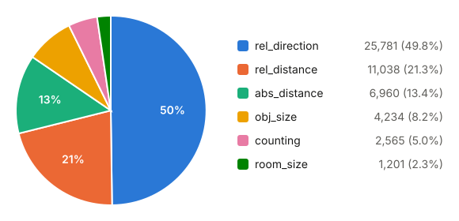

| task | samples | share | videos | samples per video |
|---|--:|--:|--:|--:|
| rel_direction | 25,781 | 49.8% | 587 | 43.9 |
| rel_distance | 11,038 | 21.3% | 579 | 19.1 |
| abs_distance | 6,960 | 13.4% | 905 | 7.7 |
| obj_size | 4,234 | 8.2% | 1,123 | 3.8 |
| counting | 2,565 | 5.0% | 1,008 | 2.5 |
| room_size | 1,201 | 2.3% | 1,201 | 1.0 |
| route_plan | 0 | 0.0% | 0 | 0.0 |
| appearance_order | 0 | 0.0% | 0 | 0.0 |
| **total** | **51,779** | | **1,201** | **43.1** |

rel_direction splits evenly over VSI-Bench's three difficulties (2, 3 or 4 options). There are no route_plan or appearance_order questions (the latter come from VSI-590K, below).

<b>rel_direction</b> (25,781 samples): <code>scannet/videos/scene0271_00.mp4</code>

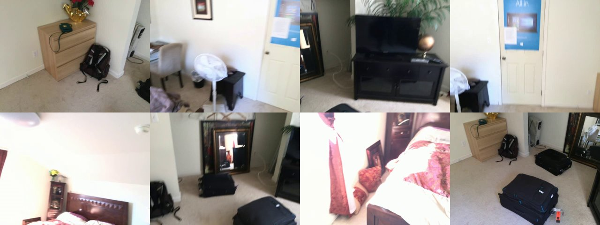

**Q:** These are frames of a video. If I am standing by the window and facing the tv, is the desk to the left or the right of the tv? Options: A. left B. right Answer with the option's letter from the given choices directly.

**A:** A

<b>rel_distance</b> (11,038 samples): <code>scannet/videos/scene0261_01.mp4</code>

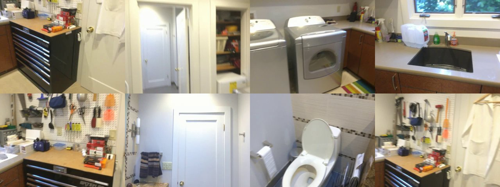

**Q:** These are frames of a video. Measuring from the closest point of each object, which of these objects (mirror, counter, window, towel) is the closest to the washing machine? If there are multiple instances of an object category, measure to the closest. Options: A. mirror B. counter C. window D. towel Answer with the option's letter from the given choices directly.

**A:** B

<b>abs_distance</b> (6,960 samples): <code>scannet/videos/scene0263_00.mp4</code>

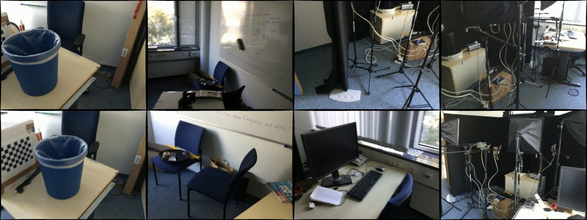

**Q:** These are frames of a video. Measuring from the closest point of each object, what is the direct distance between the radiator and the keyboard (in meters)? Please answer the question using a single word or phrase.

**A:** 0.5

<b>obj_size</b> (4,234 samples): <code>scannet/videos/scene0270_01.mp4</code>

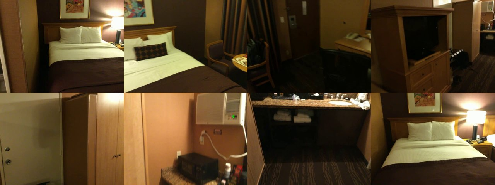

**Q:** These are frames of a video. What is the length of the longest dimension (length, width, or height) of the telephone, measured in centimeters? Please answer the question using a single word or phrase.

**A:** 38

<b>counting</b> (2,565 samples): <code>scannet/videos/scene0168_00.mp4</code>

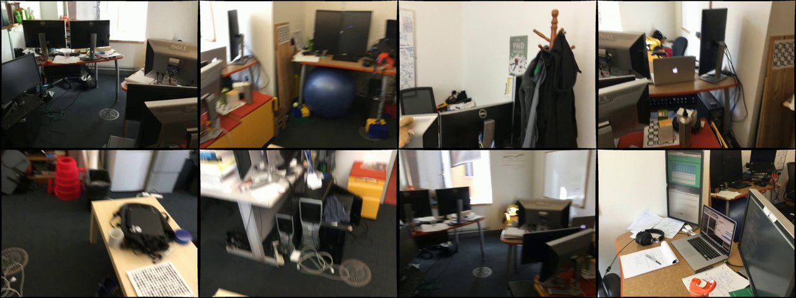

**Q:** These are frames of a video. How many monitor(s) are in this room? Please answer the question using a single word or phrase.

**A:** 9

<b>room_size</b> (1,201 samples): <code>scannet/videos/scene0106_01.mp4</code>

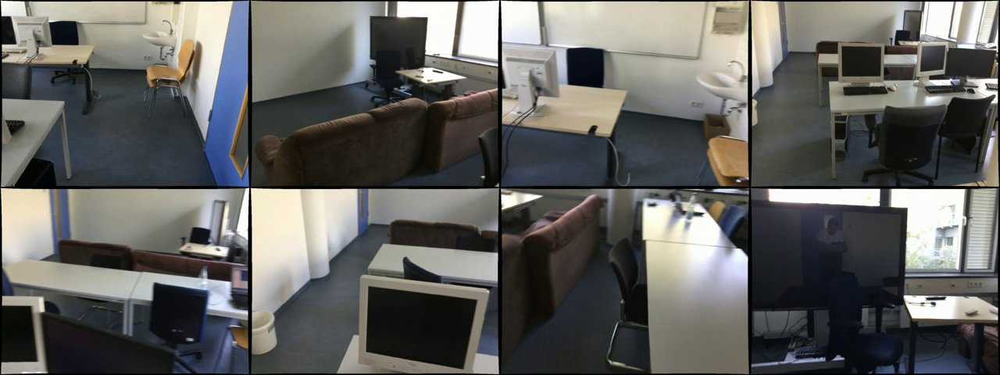

**Q:** These are frames of a video. What is the size of this room (in square meters)?  If multiple rooms are shown, estimate the size of the combined space. Please answer the question using a single word or phrase.

**A:** 37.3

## VSI-590K appearance order

Same ScanNet videos. The annotations' paths lack `videos/`, so they are rewritten here.

### `scannet/videos/scene0468_00.mp4`

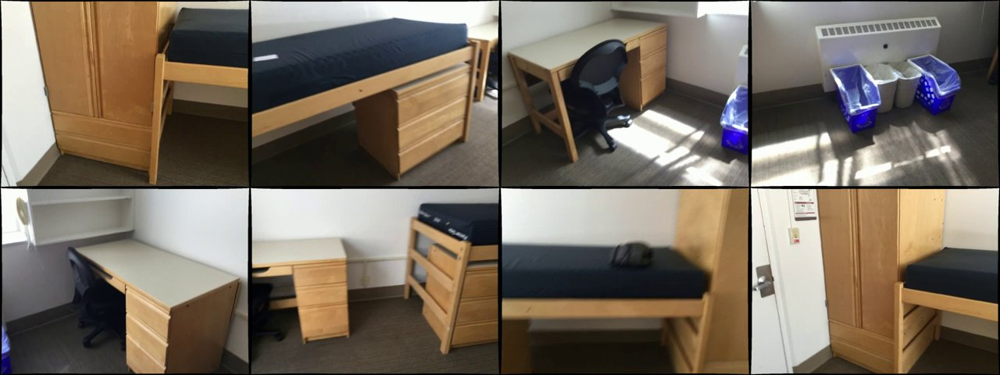

**Q:** These are frames of a video. What will be the sequence of first-time occurrences for the following video categories: window, chair, telephone, bed? Options: A. window, chair, bed, telephone B. bed, chair, window, telephone C. window, chair, telephone, bed D. bed, window, telephone, chair Answer with the option's letter from the given choices directly.

**A:** B

### `scannet/videos/scene0335_01.mp4`

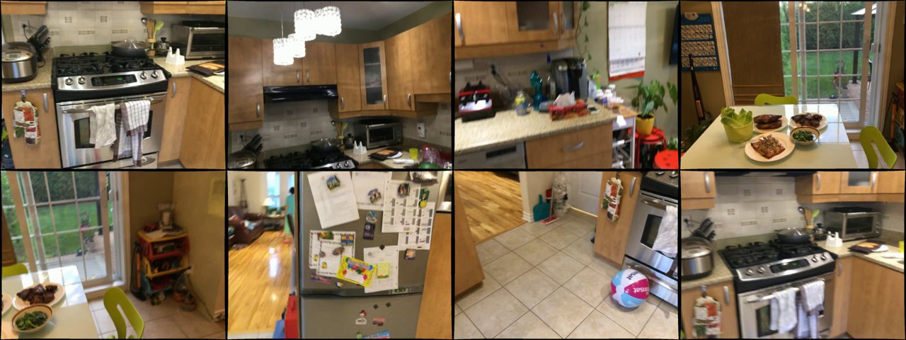

**Q:** These are frames of a video. Determine how towel, refrigerator, chair, and plant are ordered by their initial appearances in the video. Options: A. towel, plant, refrigerator, chair B. refrigerator, towel, chair, plant C. towel, plant, chair, refrigerator D. towel, refrigerator, chair, plant Answer with the option's letter from the given choices directly.

**A:** C

## SPAR-234k

Points and boxes drawn as in training. The 32-frame samples only mark the frames the question refers to; those are shown (labelled `*`), padded with uniform frames up to 8.

### distance_prediction_oc (scannet, 1 image)

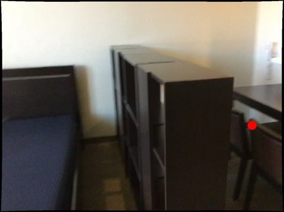

**Q:** Measure the distance between the center of chair (red point) and the observer in the image. Report it in meters. Calculate or judge based on the 3D center points of these objects.

**A:** You are located about 2.4 meters from the center of chair (red point).

### obj_spatial_relation_oo_mv (scannet, 3 images)

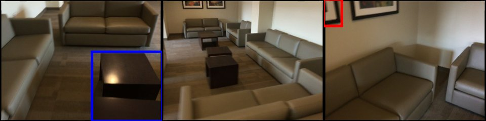

**Q:** Relative to the observer, where can the picture (red bbox) be found in relation to the coffee table (blue bbox) in the two images? Calculate or judge based on the 3D center points of these objects. To convey the observer's perspective, the first image is designated as the main focus.

**A:** the picture(red bbox), as observed, is located  above the coffee table(blue bbox). It appears to be farther from this perspective. The the picture(red bbox) is behind the observer. The the coffee table(blue bbox) is in front of the observer.

### depth_prediction_oo_mv (scannetpp, 3 images)

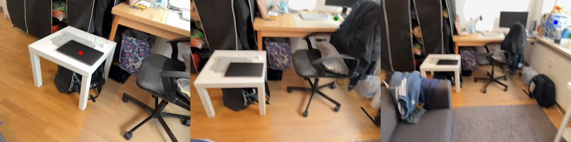

**Q:** If the depth of laptop (red point) is given as 1.1, how far apart in depth are mouse (green point) and shopping bag (blue point) in meters? Calculate or judge based on the 3D center points of these objects. The depth is calculated based on the image where the markers corresponding to these objects are located.

**A:** Using laptop (red point) as a reference at 1.1 meters, the predicted depths are 1.8 meters for mouse (green point) and 2.3 meters for shopping bag (blue point). Their relative depth difference is 0.5 meters.

### obj_count (scannetpp, 32 images)

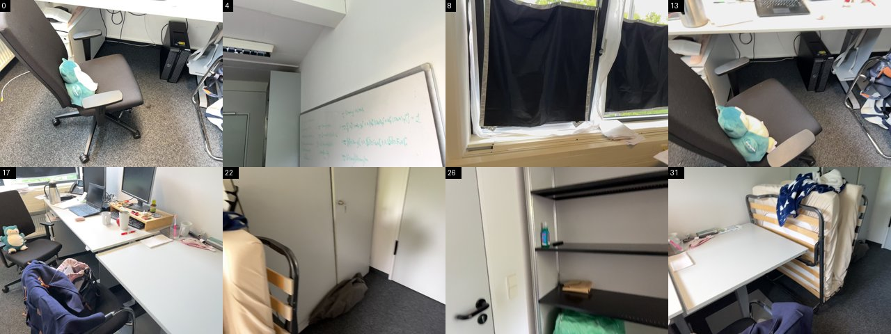

**Q:** [32 frames] Based on the video footage I sent your way, how many box appear to be in the room?

**A:** Footage shows that 5 box are located in the room.

### distance_prediction_oo_video (scannet, 32 images)

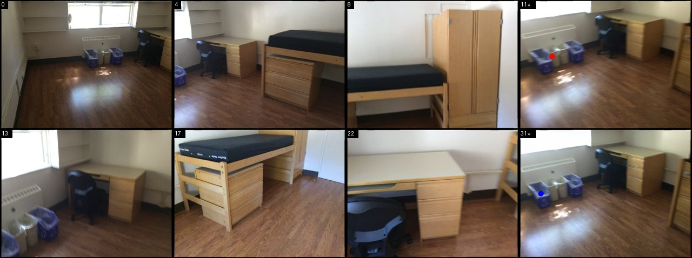

**Q:** [32 frames] Express in meters the center-to-center separation of trash can (in Frame-11) (red point) and recycling bin (in Frame-31) (blue point) in the video.

**A:** In meters, the separation between trash can (red point) and recycling bin (blue point) is calculated to be 0.2.

### spatial_imagination_oc_video (scannet, 32 images)

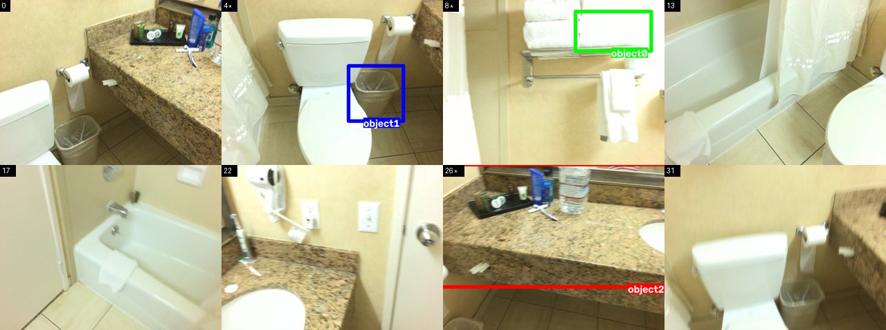

**Q:** [32 frames] What is the observer’s perspective on bathroom vanity (in Frame-26, Object2) (red bbox) after shifting to towel (in Frame-8, Object0) (green bbox) and orienting towards trash can (in Frame-4, Object1) (blue bbox)? Calculate or judge based on the 3D center points of these objects.

**A:** From the adjusted perspective at towel (Object0) facing trash can (Object1), bathroom vanity (Object2) is observed to the right below. It may also appear to the front.

### distance_infer_center_oo_video (scannetpp, 32 images)

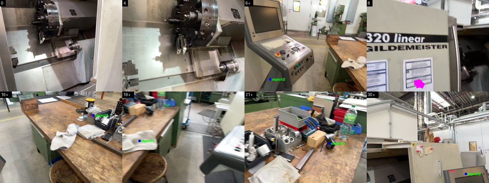

**Q:** [32 frames] Which object in control panel (in Frame-30, point0), cloth (in Frame-19, point1), mount (in Frame-6, point2), storage bin (in Frame-16, point3),  is the closest relative to tissue paper (in Frame-21) (pointA)?

**A:** With a separation of 0.5 meters, cloth (Object1) is identified as the closest to tissue paper.

### spatial_imagination_oo_video_hard (scannetpp, 32 images)

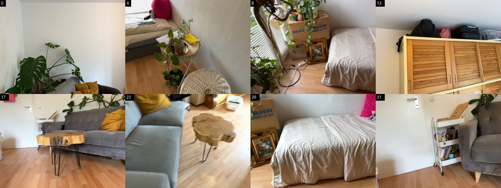

*No markers: the `_hard` tasks name objects only by category.*

**Q:** [32 frames] After the observer has moved to shelf (Object0)  and turned toward light switch (Object1) , where does slippers (Object2)  lie in relation to SPLIT (Object3) ? Calculate or judge based on the 3D center points of these objects. Please use the world coordinate system to determine the up and down position relationship of objects.

**A:** As you settle at shelf (Object0) and look toward light switch (Object1), slippers (Object2) lies to the left and below in relation to SPLIT (Object3). It seems closer. The slippers (Object2) is behind the new observer. The SPLIT (Object3) is in front of the new observer.

### depth_prediction_oc (structured3d, 1 image)

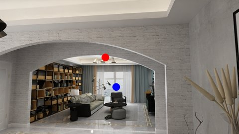

**Q:** Based on the reference depth of Object0 (red point) at 6.8 meters, calculate the depth of Object17 (blue point).  Calculate or judge based on the 3D center points of these objects. The unit is meter. Choose the correct response from the given choices. A. 14.1 B. 14.8 C. 9.3 D. 6.2 Your answer can only include one of options A, B, C or D.

**A:** C

### distance_prediction_oo_mv (structured3d, 3 images)

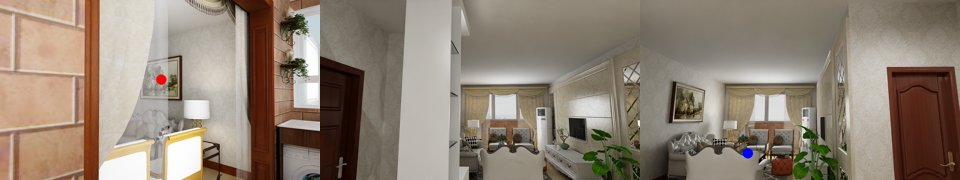

**Q:** In meters, how far is the center of Object39 (red point) from the center of Object110 (blue point)? Calculate or judge based on the 3D center points of these objects.

**A:** A separation of 2.4 meters exists between Object39's red point and Object110's blue point.

### position_matching (structured3d, 2 images)

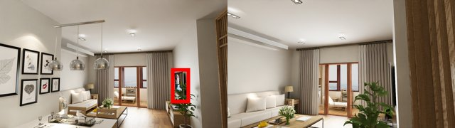

**Q:** From the red bbox of Object46 in the first image, identify its bounding box in the second image.

**A:** The second image places Object46 within the bounding box [728, 484, 764, 888], guided by the first image’s red bbox.

### view_change_infer (structured3d, 2 images)

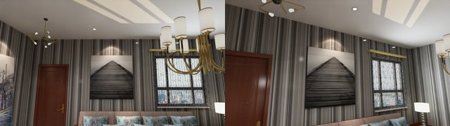

**Q:** If the first image is the main perspective, how must the observer move to capture the second image?

**A:** The camera’s required movements include: Move 1.2 meters forward. Move laterally 1.4 meters toward left. Adjust horizontal angle 30 degrees right.

### spatial_imagination_oc_mv (structured3d, 3 images)

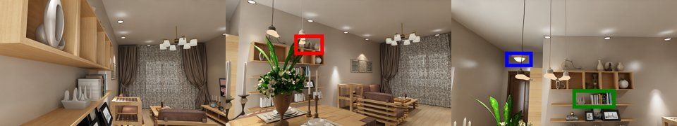

**Q:** What is the spatial position of Object23 (red bbox) relative to the observer before they move to the center of Object66 (green bbox) and face Object58 (blue bbox)? After moving, where does Object23 stand? Calculate or judge based on the 3D center points of these objects. Respond with the observer's perspective in mind, identifying the first image as the main view before any action is taken.

**A:** The observer initially perceives Object23 as to the left above. It might appear to the front. After moving to Object66 and aligning with Object58, Object23 shifts to to the right above.

### spatial_volume_infer (structured3d, 1 image)

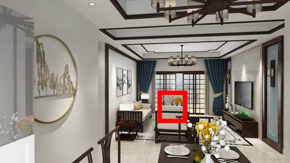

**Q:** Referring to the image I provided, what are the exact length, width, and height of Object245 in centimeters? The size (width, height, length) of the object (in centimeters). Height is the vertical size of the object, length is the longer horizontal size of the object (length>width), while width is the shorter horizontal size of the object

**A:** In precise terms, object Object245 measures 88 cm by 69 cm by 93 cm.

## LLaVA-Hound-64k

General video QA on web videos (no spatial content). 8 uniform frames shown.

### `llava_hound/frames/eWb5R1PpK9k` (30 frames)

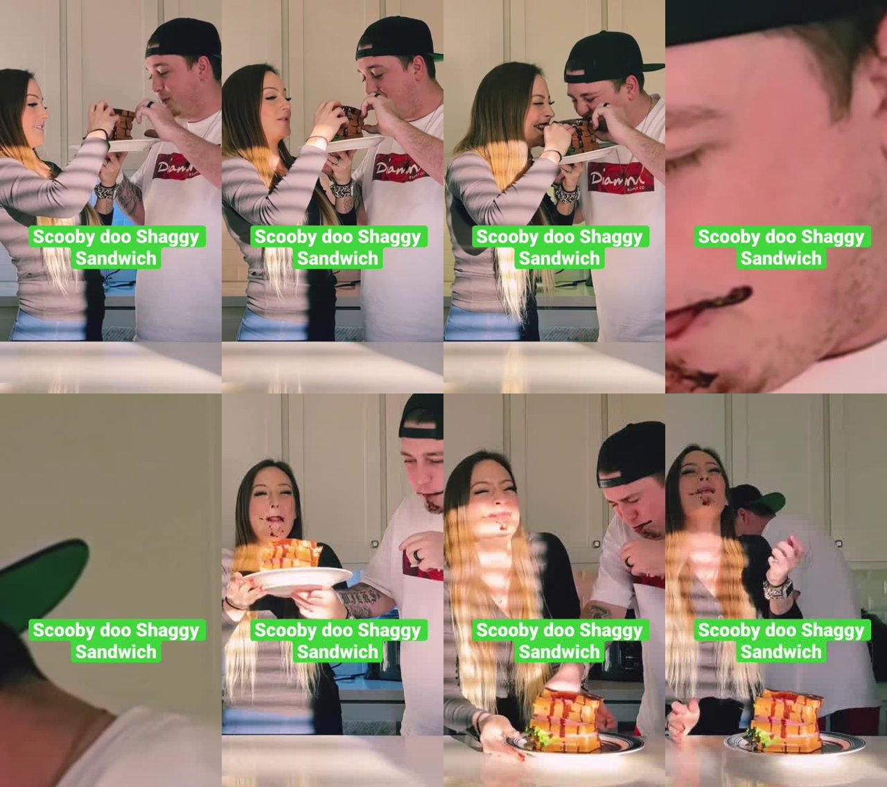

**Q:** Share a detailed breakdown of the video's storyline and visuals.

**A:** The video opens with two individuals positioned closely together, facing one another, holding a sizeable sandwich between them. They are both attempting to eat from either end of this sandwich, which appears stacked with multiple layers of ingredients, potentially resembling the character Shaggy's exaggerated sandwiches from the \"Scooby-Doo\" animation series.\n\nBoth individuals are smiling and appear amused, suggesting a lighthearted or playful atmosphere. The sandwich consists of several layers of bread and fillings, with some ingredients visibly dripping or extending out from the sides, creating a messy presentation.\n\nA text overlay is visible throughout the video, which remains static and reads \"Scooby doo Shaggy Sandwich.\" The color of the text is a contrasting bright green against the background, making it prominent. The background of the setting is interior, likely a kitchen or dining area with neutral colors.

### `llava_hound/frames/23740546` (48 frames)

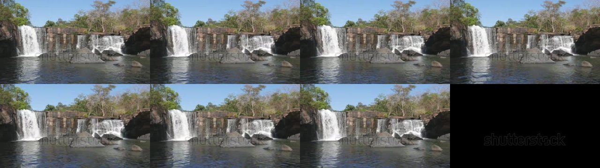

**Q:** What is the color of the water and rocks in the video?

**A:** The water in the video is a clear blue, and there are multiple shades of grey and brown amongst the rocks.

### `llava_hound/frames/15584080` (33 frames)

**Q:** What is the background like in the video?

**A:** The background is bright.

### `llava_hound/frames/IfGKBHqTWIA` (20 frames)

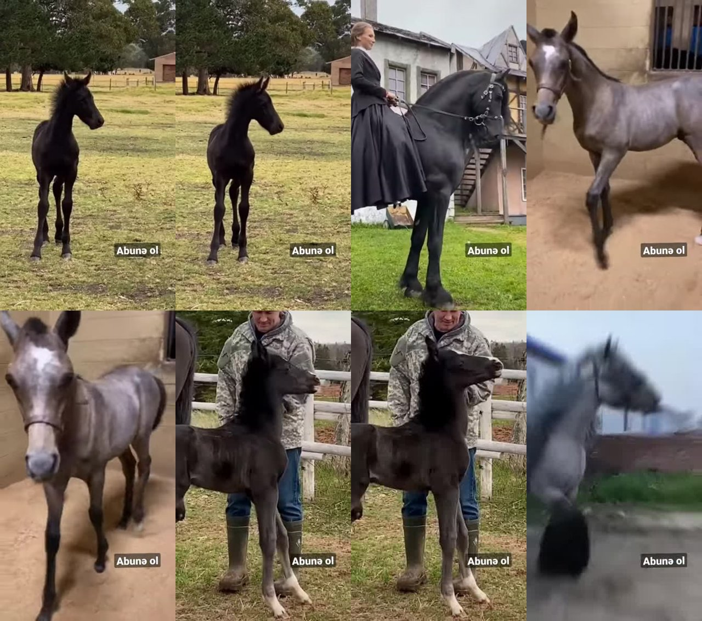

**Q:** Convey the narrative and visual elements of the video in detail.

**A:** The video is a montage showcasing several horses. The first scene depicts a dark brown foal standing in a grassy field with trees in the background, followed by similar scenes with varying backdrops, including a house with distinctive architectural features, a stable setting, and an expansive outdoor environment. One clip features a horse with a rider, both adorned in black attire, while other segments reveal horses with different coat colors ranging from dark brown to grey, engaged in activities such as walking, running, or standing. There is a consistent textual overlay on all frames. The environment suggests rural or farm locations. The horses appear well-cared for, highlighting their glossy coats and active stances.
