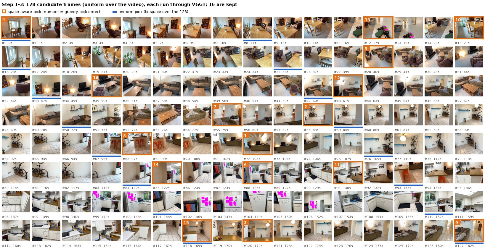
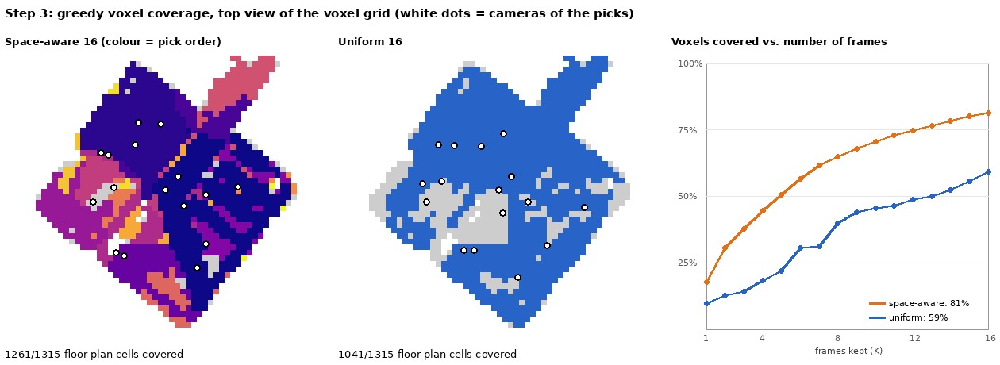
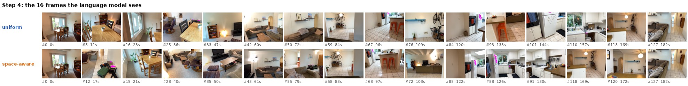
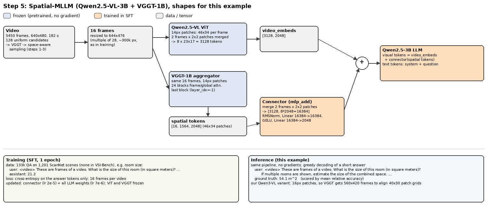

# Walkthrough: one VSI-Bench question, from video to answer

This follows one question through the whole Spatial-MLLM-style pipeline: candidate frames, VGGT, space-aware
frame sampling, the language model, and how such a model is trained. Steps 1-4 show real outputs on our data.
Step 5 describes Spatial-MLLM's training and model with the tensor shapes this example would produce. We have
not trained that model.

**The question.** Question 2707 (VSI-Bench-Debiased), `scannetpp/09c1414f1b`, a 182 s walk through a flat
([▶ video](../data/previews/scannetpp/09c1414f1b.webm) · [mp4](../data/raw/VSI-Bench/scannetpp/09c1414f1b.mp4)):

> What is the size of this room (in square meters)? If multiple rooms are shown, estimate the size of the combined space.

Ground truth: **54.1 m²**. Scoring uses mean relative accuracy (MRA), so 0 means off by more than 50% and 1
means within 5%. Qwen3-VL-4B zero-shot answers 27.0 with 8 frames and 32.7 with 32 frames (MRA 0.0 / 0.3).
Answering it needs two things:
- having seen the whole flat (coverage);
- knowing how big things are (metric scale).

## Step 1: 128 candidate frames

The video has 5,450 frames. Like Spatial-MLLM, we take 128 uniformly spaced candidates
(`np.linspace(0, 5449, 128, dtype=int)`), about one every 1.4 s.



## Step 2: VGGT on all 128 frames

The frozen VGGT-1B makes **one joint forward pass** over all 128 frames.
- **Input:** each frame is resized to 518×392, so 28×37 patches of 14 px.
- **Aggregator:** 24 blocks that alternate attention within a frame and across all frames. This takes 4 s on a B200.
- **Heads:**
  - the camera head reads the last block's camera token and gives a pose and intrinsics for every frame;
  - two DPT heads read blocks 4/11/17/23 and give a depth map and a 3D point map, each with a confidence.


Everything is saved in `data/vggt/scannetpp/09c1414f1b/` (see the README). All of it is in VGGT's own units:
- The first camera sits at the origin.
- The scene has an arbitrary global scale; median depth is 0.4 "units".

The reconstruction already contains the layout of the flat, but not its size in metres.

## Step 3: space-aware frame sampling

The language model only gets 16 frames, so we need to pick which 16. Spatial-MLLM picks them greedily, by how
much of the scene each frame shows. `src/mvp/reconstruction/sa_sampling.py` re-implements this on the saved point maps. On this
scene it selects exactly the same frames as the original Spatial-MLLM functions.

1. **Confident points.** Keep the points whose `world_points_conf` is at least the median over all 26M points
   (6.68 here) and above 0.1.
2. **Voxel grid.** Put a bounding box around those points. The voxel size is the shortest box side / 20, which is
   0.067 units here, giving a 47×21×49 grid. The confident points occupy 5,048 voxels.
3. **Per-frame voxel sets.** For each candidate frame, record the voxels its confident points fall in.
4. **Greedy maximum coverage.** Repeatedly add the frame that covers the most voxels not yet covered:

   | pick | 1 | 2 | 3 | 4 | 5 | 6 | 7 | 8 | 9 | 10 | 11 | 12 | 13 | 14 | 15 | 16 |
   |---|---|---|---|---|---|---|---|---|---|---|---|---|---|---|---|---|
   | candidate frame | #72 | #58 | #120 | #0 | #28 | #88 | #55 | #68 | #127 | #15 | #91 | #43 | #12 | #85 | #118 | #35 |
   | new voxels | 900 | 649 | 364 | 344 | 298 | 295 | 261 | 161 | 157 | 141 | 107 | 103 | 91 | 85 | 83 | 67 |

   The first pick (#72, 103 s) is a wide view across the living room. Each later pick adds the largest part of the
   flat not seen yet, so the gains shrink. Frames that mostly repeat earlier views are never picked.



With 16 frames, space-aware sampling covers **81%** of the voxels, against **59%** for 16 uniform frames. Uniform
sampling spends its first four frames (0-36 s) on the dining area and leaves larger parts of the scene unseen
(grey cells).

## Step 4: what the language model sees, and what it answers



We gave Qwen3-VL-4B (zero-shot, our VSI-Bench protocol) 16 frames chosen in three ways. Each run uses 2,586
input tokens:
- `qwen`: qwen-vl-utils uniform over the whole video;
- `uniform128`: uniform over the 128 candidates;
- `sa`: space-aware.

| frames | prediction for q2707 | MRA | all 63 questions of this scene |
|---|---|---|---|
| uniform over the video (`qwen`) | 30.7 | 0.2 | 45.1 |
| uniform over the 128 candidates | 30.7 | 0.2 | 46.4 |
| space-aware | 30.3 | 0.2 | 45.1 |

**Better coverage did not change the answer.** The model sees most of the flat but still says about 30 m². That is
a "typical flat" guess, not a measurement. Across the 63 questions of this scene, 12 answers flip between uniform
and space-aware frames, in both directions. One scene is far too little to judge the sampler; the full benchmark
run is the next step.

What this example suggests is that frame choice alone does not give the model metric geometry. Spatial-MLLM
therefore also feeds VGGT's features into the model and trains it to use them.

Reproduce: `slurm/submit.sh -J wt -t 00:30:00 -- .venv/bin/python -m mvp.eval.vsibench --model Qwen/Qwen3-VL-4B-Instruct --nframes 16 --sampling sa --scenes 09c1414f1b --out results/figures/walkthrough/4B_f16_sa.jsonl`
(also `--sampling qwen` / `uniform128`).

## Step 5: Spatial-MLLM, training and inference



**Model.** Spatial-MLLM adds a second visual stream to Qwen2.5-VL-3B:
- **2D stream.** Qwen's own ViT turns the 16 frames (644×476) into 3,128 visual tokens: 2 frames × 2×2 patches
  are merged into one token.
- **3D stream.** VGGT runs again, on the same 16 frames at the same resolution, so its 14 px patch grid (46×34)
  lines up exactly with Qwen's. Its last aggregator layer gives 16 × 1,564 tokens of size 2048.
- **Connector.** It merges the same 2 frames × 2×2 patches into one 16,384-d vector per visual token, then maps it
  to the LLM's 2048 dimensions. It is an RMSNorm and a 2-layer MLP with 302M parameters.
- **Fusion.** The connector output is *added* to Qwen's visual token. Sequence length is unchanged, so the LLM
  sees the same 3,128 visual tokens, now carrying geometry.

**Training (published SFT recipe, `scripts/training/spatial_mllm_train_demo.sh`).**
- **Data:** 133k QA pairs on 1,201 ScanNet scenes, none of which appear in VSI-Bench. A real training sample from
  `data/raw/Spatial-MLLM-Data/annotation/spatial-mllm-mix-133k.jsonl`:

  ```
  video: scannet/videos/scene0191_00.mp4
  user:  <video> These are frames of a video. What is the size of this room (in square meters)?
         If multiple rooms are shown, estimate the size of the combined space.
         Please answer the question using a single word or phrase.
  assistant: 21.2
  ```
- **Loss:** cross-entropy on the answer tokens only.
- **What is trained:**
  - the connector (lr 2e-5) and all LLM weights (lr 7e-6);
  - the ViT and VGGT stay frozen.
- **Schedule:** 16 frames per video, 1 epoch, effective batch 48 (1 × 8 accumulation × 6 GPUs).
- Room-size answers in this data have a median of 15.9 m², and 95% are below 37 m². Our 54.1 m² ScanNet++ flat is
  larger than almost anything seen in training.

**Inference** is the same forward pass without gradients. The prompt above, with greedy decoding, gives a short
answer that is scored by MRA. For VSI-Bench, the 16 frames are the space-aware frames from step 3.

**For our project** (Qwen3-VL 2B/4B):
- **Patch alignment.** Qwen3-VL uses 16 px patches, so the 480×640 frames give a 30×40 grid. To align VGGT's
  14 px grid with it, VGGT should get the frames at 420×560.
- **Connector size.** The connector output becomes 2560-d for the 4B model, with 310M parameters.
- **Fine-tuning.** Our plan replaces full fine-tuning with LoRA on the LLM and keeps the connector trainable.
- **Feature cache.** The 128-frame features saved in `data/vggt/` are from a different pass (518-wide frames, all
  128 frames jointly). They are what the sampler needs. The fused model would compute its own VGGT tokens on the
  16 chosen frames, or we cache those separately.

Figures: `.venv/bin/python -m mvp.reporting.walkthrough --video scannetpp/09c1414f1b` (light, runs on the login node).
